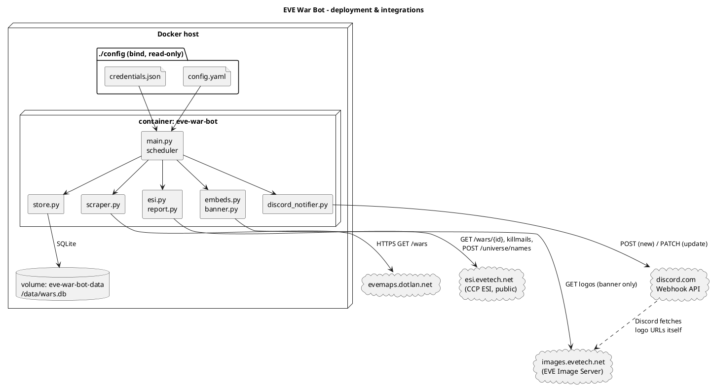
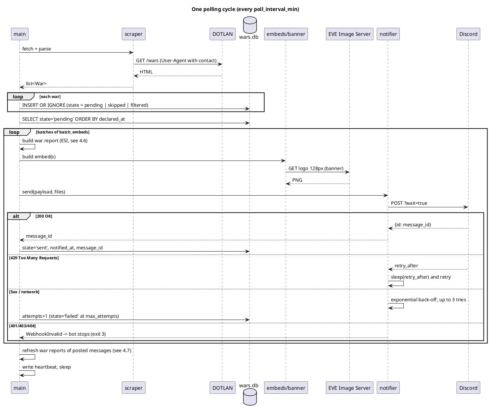
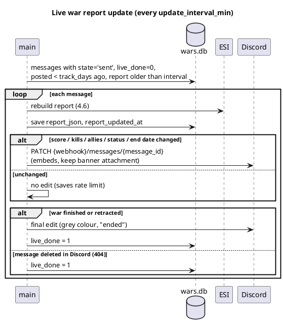
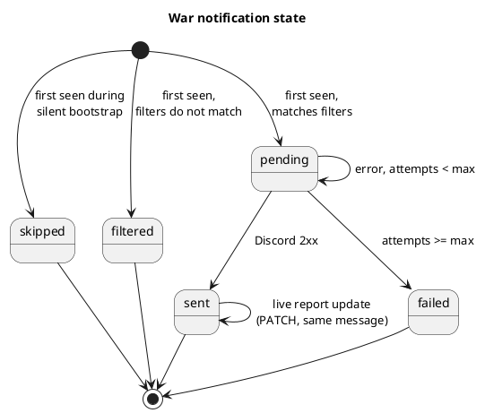
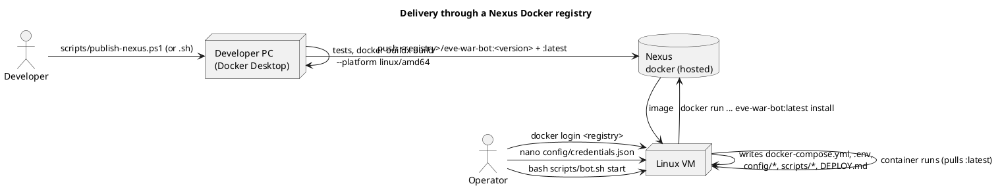

# EVE War Bot — DOTLAN Wars → Discord

A small Python service in Docker. It watches the DOTLAN war list (`https://evemaps.dotlan.net/wars`) and posts each **new** war declaration to a Discord channel as a message with logos and a banner image. The message also carries a **war report** — the same kind of content as a DOTLAN war page such as `https://evemaps.dotlan.net/war/763527`: timeline, score (ships killed, ISK destroyed, efficiency), defender allies, recent kills and hot systems. The report is kept up to date by editing the same Discord message while the war runs. It remembers what it has already posted in a SQLite database on a Docker volume, so restarting or rebuilding the container does not create duplicates.

> **New to servers?** Follow the step-by-step guide in [`docs/MANUAL.md`](docs/MANUAL.md): from an empty DigitalOcean droplet to a running bot, copy-and-paste only.

---

## 1. Project layout

```text
eve-war-bot/
├── Dockerfile                    # container image definition
├── docker-compose.yml            # service, volumes, restart policy
├── requirements.txt              # Python dependencies (pinned)
├── .dockerignore / .gitignore    # credentials.json is excluded from image & git
├── .env.example                  # optional: use the prebuilt image from GHCR
├── nexus.env.example             # Nexus registry settings for the publish scripts (copy to nexus.env)
├── deploy/
│   ├── docker-compose.yml        # server compose file (image from a registry, no build) - shipped in the image
│   └── DEPLOY.md                 # short server guide - shipped in the image
├── .github/workflows/docker.yml  # CI: tests + build image on GitHub -> ghcr.io
├── docs/MANUAL.md                # beginner step-by-step deployment guide
├── scripts/
│   ├── setup-droplet.sh          # server prep, only adds what is missing: tools, swap, Docker (never touches firewall/ports)
│   ├── bot.sh                    # init | check | test | start | stop | restart | logs | status | update | backup
│   ├── publish-nexus.sh          # build + push the image to Nexus (Linux/macOS)
│   └── publish-nexus.ps1         # same for Windows (Docker Desktop)
├── config/
│   ├── credentials.example.json  # TEMPLATE with empty fields -> copy to credentials.json
│   └── config.yaml               # non-secret settings (interval, filters, images ...)
├── app/
│   ├── main.py                   # scheduler loop: read -> store -> notify -> update reports
│   ├── config.py                 # loads config.yaml + credentials.json, validates
│   ├── scraper.py                # DOTLAN HTML -> War objects
│   ├── esi.py                    # CCP ESI client (wars, killmails, names) - war report data
│   ├── report.py                 # builds the war report (score, allies, kills, systems)
│   ├── store.py                  # SQLite notification storage (dedup)
│   ├── embeds.py                 # rich Discord embed builder
│   ├── banner.py                 # "Aggressor VS Defender" PNG generator (Pillow)
│   ├── discord_notifier.py       # Discord webhook client: post + edit, rate limits, retries
│   ├── installer.py              # `install` command: unpacks the deployment bundle from the image
│   ├── healthcheck.py            # Docker HEALTHCHECK
│   └── models.py                 # War / Party data classes
└── tests/                        # pytest, saved HTML page, fake ESI, mock Discord server
```

---

## 2. Quick start

1. **Create a Discord webhook.** In Discord, open the channel → *Edit Channel* → *Integrations* → *Webhooks* → *New Webhook* → *Copy Webhook URL*.
2. **Fill in the credentials file.**
   ```bash
   cp config/credentials.example.json config/credentials.json
   # edit config/credentials.json
   ```
   > Create `credentials.json` **before** the first `docker compose up`. If the file is missing, Docker creates an empty *directory* with that name, and the bot stops with "Credentials file not found".
3. **Optionally adjust `config/config.yaml`** (polling interval, filters, banner).
4. **Start the bot.**
   ```bash
   docker compose up -d --build
   docker compose logs -f
   ```
5. **Test without posting.** Set `runtime.dry_run: true` in `config.yaml` or uncomment `DRY_RUN=true` in `docker-compose.yml`. The bot then logs the Discord payloads instead of sending them, and the webhook URL may be empty.

On the **first run**, all wars currently listed are stored as `skipped` and nothing is posted (`bootstrap_silent: true`). From then on, only wars that appear later are posted.

---

## 3. Credentials file

`config/credentials.json` is the only place secrets are kept. It is mounted read-only into the container. It is never copied into the image (`.dockerignore`) and never committed to git (`.gitignore`).

```json
{
  "discord": {
    "webhook_url": "",
    "mention_role_id": ""
  },
  "dotlan": {
    "contact": ""
  }
}
```

| Field | Required | Meaning |
|---|---|---|
| `discord.webhook_url` | yes (unless dry run) | Full webhook URL `https://discord.com/api/webhooks/{id}/{token}`. Anyone who has it can post to the channel, so treat it as a password. |
| `discord.mention_role_id` | no | Numeric Discord role ID to ping with each message (Developer Mode → right-click role → *Copy Role ID*). Leave empty for no ping. |
| `dotlan.contact` | recommended | E-mail address or Discord handle. It is added to the HTTP `User-Agent` so the DOTLAN operator can contact you instead of blocking you. |

The file is checked at startup. An empty webhook, a malformed URL, a non-numeric role ID or invalid JSON stops the bot with **exit code 2** and a clear log message. To check the files without starting the bot:

```bash
docker compose run --rm eve-war-bot --check-config
```

Paths can be changed with the `CREDENTIALS_FILE` and `CONFIG_FILE` environment variables.

---

## 4. How the integration works

### 4.1 Architecture



### 4.2 Polling cycle



### 4.3 Integration 1 — DOTLAN (data source)

| Aspect | Detail |
|---|---|
| Endpoint | `GET https://evemaps.dotlan.net/wars` (`/wars/kills`, `/wars/mutual` and `/wars/open` via `dotlan.view`) |
| Auth | none |
| Format | HTML. DOTLAN has no public JSON API for this list, so the page is parsed (BeautifulSoup). |
| Pagination | none, all active wars are on one page |
| Frequency | `poll_interval_min` (default 15). DOTLAN is a community-run site, so keep this low. |
| Headers | `User-Agent: eve-war-bot/1.3.0 (+<contact>)` |
| Not used | `/war/{id}` pages — DOTLAN's `robots.txt` disallows them for bots, so the war report is built from ESI instead (4.6) |

**Row structure and parsing.** Each table row has these cells: *Declared* · aggressor logo · aggressor name · defender logo · defender name · status · *War Report*. The header row has stray empty cells, so the parser does not count columns. It finds each piece by its URL pattern:

| Data | Found by | Example |
|---|---|---|
| `war_id` (unique key) | link `/war/{id}` | `/war/763527` |
| party name and type | links `/alliance/{Name}/wars` or `/corp/{Name}/wars`; first = aggressor, second = defender | `/corp/Les_Corbeaux_de_New_Eden/wars` |
| full name | taken from the URL slug (`_` → space, URL-decoded), because link text is cut off with `...` | `From Hisec with Love Coalition` |
| EVE entity ID | logo `src` `.../Alliance/{id}_32.png` or `.../Corporation/{id}_32.png` | `99003581` |
| members | `Members: N` in the name cell | `54418` |
| declared (UTC/EVE time) | `YYYY-MM-DD` and `HH:MM:SS` in either order | `2026-10-23T14:25:00Z` |
| status | text `Mutual` / `Open For Allies` / none | `mutual` |

A row that cannot be parsed is logged and skipped. If the page has a table but **no** rows can be parsed, a `ScrapeError` is logged, because DOTLAN has probably changed its layout. The service keeps running either way. When this happens, update `scraper.py` and add a real saved copy of the page to `tests/fixtures/wars.html`.

### 4.4 Integration 2 — EVE Image Server (images)

| Aspect | Detail |
|---|---|
| Alliance logo | `https://images.evetech.net/alliances/{id}/logo?size=128` |
| Corporation logo | `https://images.evetech.net/corporations/{id}/logo?size=128` |
| Auth | none (official CCP image service) |
| Fallback | the DOTLAN 32 px logo URL found on the page |

The images are used in two ways:

1. **Embed images (URLs only).** The aggressor logo (64 px) appears as the author icon and the defender logo (128 px) as the thumbnail. Discord's servers download these images; the bot only sends the URLs.
2. **Banner (uploaded file).** `banner.py` downloads both logos and draws a 640×220 PNG: aggressor logo · red "VS" · defender logo, with names underneath. The PNG is uploaded with the message as an attachment. If a logo cannot be downloaded, the message is sent without the banner. Turn this off with `images.banner_enabled: false`.

### 4.5 Integration 3 — Discord Webhook API (notifications)

**Request (no banner)**: `POST {webhook_url}?wait=true`, `Content-Type: application/json`

```json
{
  "username": "EVE War Watch",
  "content": "<@&123456789012345678>",
  "allowed_mentions": { "roles": ["123456789012345678"] },
  "embeds": [{
    "author":   { "name": "NuKeDD. declared war", "url": "https://evemaps.dotlan.net/alliance/NuKeDD./wars",
                  "icon_url": "https://images.evetech.net/alliances/99010678/logo?size=64" },
    "title":    "⚔ NuKeDD. → Fraternity.",
    "url":      "https://evemaps.dotlan.net/war/763527",
    "color":    12597547,
    "thumbnail":{ "url": "https://images.evetech.net/alliances/99003581/logo?size=128" },
    "fields": [
      { "name": "Aggressor", "value": "**[NuKeDD.](…)**\n🛡 Alliance · 13 members", "inline": true },
      { "name": "Defender",  "value": "**[Fraternity.](…)**\n🛡 Alliance · 54,418 members", "inline": true },
      { "name": "Status",    "value": "Standard", "inline": true },
      { "name": "Declared (EVE time)", "value": "<t:1792765500:F>\n<t:1792765500:R>", "inline": true },
      { "name": "Links", "value": "[War report](…) · [Aggressor wars](…) · [Defender wars](…)" }
    ],
    "image":    { "url": "attachment://war_763527.png" },
    "footer":   { "text": "Source: DOTLAN EveMaps · War #763527" },
    "timestamp":"2026-10-23T14:25:00+00:00"
  }]
}
```

**Request (with banner)**: the same JSON goes in a `multipart/form-data` field called `payload_json`, plus one field per image, `files[0]`, `files[1]`, …, plus an `attachments` list (`[{"id":0,"filename":"war_763527.png"}]`). The embed shows the uploaded file through `image.url = attachment://war_763527.png`.

**Response.** Because of `?wait=true`, Discord returns the created message object. Its `id` is saved in the database (`discord_message_id`), so a notification can be traced to its Discord message, or edited or deleted later.

**Embed elements**

| Element | Content |
|---|---|
| Colour | red = standard · orange = Open For Allies · purple = Mutual |
| `<t:unix:F>` / `<t:unix:R>` | Discord shows the date in each reader's own time zone, plus a relative time ("3 hours ago") |
| `allowed_mentions` | only the configured role can be pinged; names that contain `@everyone` cannot trigger a ping |
| Batching | `batch_embeds: 1..10` puts up to 10 wars into one message (Discord's limit) |
| Size limits | title ≤ 256 characters and field ≤ 1024 are enforced; the whole embed must stay ≤ 6000 characters |

**Rate limits and errors**

| Discord response | Bot behaviour |
|---|---|
| `2xx` | marked `sent`. If `X-RateLimit-Remaining: 0`, waits `X-RateLimit-Reset-After` before the next post. |
| `429` | sleeps for `retry_after` (from the body, or the `Retry-After` header) + 0.25 s, then retries the same message |
| `5xx` / timeout / network | retries with exponential back-off (2, 4, 8 s), up to 3 tries per cycle. Then `attempts+1`; the war stays `pending` and is tried again next cycle. |
| other `4xx` (e.g. 400 bad payload) | `attempts+1` without retrying (sending the same payload again would fail the same way) |
| `401` / `403`, or `404` on a new post | the webhook is wrong or deleted. The bot logs a CRITICAL error and **exits with code 3**, without using up any war's attempts. Docker restarts it, and it keeps failing until `credentials.json` is fixed. |
| `404` on an edit (PATCH) | the message was deleted in Discord: the bot stops updating that war, nothing else changes |
| `attempts >= max_attempts` (5) | state becomes `failed`; that war is never retried |

On top of this, the bot always waits at least `min_seconds_between_posts` (default 2 s) between posts. That keeps it under Discord's webhook limit of about 30 messages per minute, even when many wars arrive at once.

### 4.6 Integration 4 — CCP ESI (war report content)

The DOTLAN war page (`/war/{id}`) is built from data that CCP publishes through ESI, the official EVE API. DOTLAN's `robots.txt` does not allow bots on those pages, so the bot reads the same data straight from ESI. ESI is meant for programs, needs no login for these endpoints, and the DOTLAN war ID is used as the ESI war ID.

| Call | Used for |
|---|---|
| `GET /wars/{war_id}/` | declared / started / finished / retracted dates, mutual, open for allies, aggressor and defender `ships_killed` + `isk_destroyed`, list of defender allies |
| `GET /wars/{war_id}/killmails/?page=N` | references to all kills in the war (`killmail_id`, `killmail_hash`), up to 2000 per page, page count in `X-Pages` |
| `GET /killmails/{id}/{hash}/` | details for the newest `kill_details_limit` kills: victim, ship type, solar system, time |
| `GET /alliances/{id}/` · `GET /corporations/{id}/` | tickers, shown as `[TICKER]` next to the names |
| `POST /universe/names/` | turns IDs into names (ships, systems, pilots, corps, alliances), up to 1000 IDs per call |

**What the bot does with it**

| Report section | Built from |
|---|---|
| 🕒 Timeline | declared, starts (wars start ~24 h after declaration), retracted, finished |
| 🔴 / 🔵 Score | ships killed and ISK destroyed per side; efficiency = own ISK destroyed ÷ ISK destroyed by both sides |
| 🤝 Defender allies | names of all allies, first `max_allies` shown, then "+N" |
| 💥 Recent kills | newest `recent_kills` kills: ship (linked to zKillboard), victim, system, relative time. 🔴 = aggressor lost the ship, 🔵 = defender side lost it |
| 📍 Hot systems | the 3 systems with the most kills among the fetched kill details |
| 🔗 Links | DOTLAN war report · zKillboard war page · both parties' DOTLAN war lists |

Kills are read only once the war has started; before that, the score shows 0. The report is stored as JSON (`wars.report_json`), so a restart does not lose it.

**Caching and limits.** Names are cached in SQLite (`names` table), so each ID is looked up only once. ESI allows a limited number of failed requests: the client watches `X-ESI-Error-Limit-Remain` and pauses when it gets low, waits on HTTP 420 / 429, and retries 5xx errors. If ESI is unavailable, the war is still posted, just without the report section, and the report is added on a later update.

**Versioning.** The base URL (`report.esi_base_url`, default `https://esi.evetech.net/latest`) and the `X-Compatibility-Date` header (`report.esi_compatibility_date`) can be configured. CCP is moving ESI to date-based versioning; if the `/latest/` routes are retired, change the base URL to `https://esi.evetech.net` and set a current compatibility date.

**Example message with the report** (illustrative values)

```text
⚔ NuKeDD. → Fraternity.                                     [defender logo]
Aggressor                     Defender                     Status
NuKeDD. [NUKE]                Fraternity. [FRAT]           Standard
🛡 Alliance · 13 members       🛡 Alliance · 54,418 members
🕒 Timeline
Declared: 23 October 2026 16:25 (5 hours ago)
Starts:   24 October 2026 16:25 (in 19 hours)
🔴 Aggressor score            🔵 Defender score
Ships killed: 4               Ships killed: 1
ISK destroyed: 1.50b          ISK destroyed: 250.00m
Efficiency: 86%               Efficiency: 14%
🤝 Defender allies (2)
Ally Corp, Ally Alliance
💥 Recent kills (2 total)
🔴 Hurricane · Nuke Corp · Jita · 3 hours ago
🔵 Rifter · Pilot A · Jita · 4 hours ago
📍 Hot systems
Jita (2)
🔗 Links
DOTLAN war report · zKillboard · Aggressor wars · Defender wars
[ banner: aggressor logo  VS  defender logo ]
Source: DOTLAN EveMaps + ESI · War #763527 · report updated • today 21:30
```

### 4.7 Live report updates (editing the Discord message)

A war posted at declaration has no kills yet. Instead of posting a new message every time something changes, the bot edits the message it already posted.



| Rule | Value |
|---|---|
| Request | `PATCH {webhook_url}/messages/{message_id}` with `embeds` and `attachments: [{"id": <banner id>}]` so the banner stays |
| When | every `update_interval_min` (60), only if the report really changed |
| Stops when | the war is finished or retracted (one final edit, grey colour), the message is deleted, or `track_days` (7) have passed |
| Several wars in one message | with `batch_embeds > 1`, all embeds of that message are rebuilt and edited together |
| Restarts | the message ID, banner attachment ID and last report are in SQLite, so updates continue after a restart |

Live updates edit existing messages, so they never create duplicates. Turn them off with `report.live_updates: false`, or turn the whole report off with `report.enabled: false`.

---

## 5. Notification storage (no duplicates)

### 5.1 Where

SQLite file `/data/wars.db` on the named Docker volume `eve-war-bot-data`. The volume outlives `docker compose restart`, `down`/`up`, image rebuilds and host reboots. Only `docker compose down -v` or `docker volume rm` deletes it.

### 5.2 Schema

```sql
CREATE TABLE wars (
  war_id             INTEGER PRIMARY KEY,   -- DOTLAN war id = dedup key
  declared_at        TEXT,
  payload            TEXT NOT NULL,         -- parsed War as JSON (resend after restart)
  state              TEXT NOT NULL,         -- pending | sent | skipped | filtered | failed
  attempts           INTEGER NOT NULL DEFAULT 0,
  last_error         TEXT,
  first_seen_at      TEXT NOT NULL,
  notified_at        TEXT,
  discord_message_id TEXT,
  report_json        TEXT,                  -- last war report from ESI (v1.1)
  report_updated_at  TEXT,
  attachments_json   TEXT,                  -- Discord attachment ids (banner) for edits
  live_done          INTEGER NOT NULL DEFAULT 0   -- 1 = message no longer updated
);
CREATE TABLE meta  (key TEXT PRIMARY KEY, value TEXT NOT NULL);  -- bootstrapped_at
CREATE TABLE names (id INTEGER PRIMARY KEY, name TEXT, category TEXT, updated_at TEXT);  -- ESI name cache
```

A database created by v1.0 is upgraded automatically on start: the new columns are added and existing rows are kept.

### 5.3 State machine



### 5.4 Why duplicates cannot happen

1. `war_id` is the primary key, and new wars are written with `INSERT OR IGNORE`. Fetching the same page again never resets a war that is already stored.
2. Only rows in state `pending` are sent. A row becomes `sent` only after Discord confirms with 2xx.
3. The database runs in WAL mode with `synchronous=FULL`, so a status change is on disk before the next message is sent.
4. Wars that are `pending` when the container stops are saved with their full data (`payload`). They are sent after restart, even if DOTLAN no longer lists them.

**Remaining edge case.** If the container is killed in the few milliseconds between Discord accepting a message and the database saving `sent`, that one message is sent again after restart. Fully ruling this out is not possible with a webhook, because Discord webhooks have no "send only once" key. Normal stops (`docker stop` sends SIGTERM) let the current message finish before the bot exits.

### 5.5 Operations

```bash
# What is stored?
docker compose exec eve-war-bot python -c \
 "import sqlite3;c=sqlite3.connect('/data/wars.db');print(c.execute('select state,count(*) from wars group by state').fetchall())"

# Back up the database
docker run --rm -v eve-war-bot-data:/data -v "$PWD":/backup alpine cp /data/wars.db /backup/

# Retry wars that gave up
docker compose exec eve-war-bot python -c \
 "import sqlite3;c=sqlite3.connect('/data/wars.db');c.execute(\"update wars set state='pending',attempts=0 where state='failed'\");c.commit()"

# Full reset (next start bootstraps silently again)
docker compose down -v
```

---

## 6. Settings (`config/config.yaml`)

| Key | Default | Description |
|---|---|---|
| `dotlan.view` | `""` | `""` active · `kills` · `mutual` · `open` |
| `dotlan.poll_interval_min` | 15 | minutes between checks |
| `dotlan.bootstrap_silent` | true | first run stores existing wars without posting them |
| `discord.username` / `avatar_url` | `EVE War Watch` / – | name and picture the webhook posts as |
| `discord.batch_embeds` | 1 | wars per message (1–10) |
| `discord.min_seconds_between_posts` | 2 | pause between posts |
| `discord.max_attempts` | 5 | tries before a war is marked `failed` |
| `images.logo_size` | 128 | thumbnail size (32/64/128/256) |
| `images.banner_enabled` | true | attach the generated VS banner |
| `report.enabled` | true | add the war report (ESI) to messages |
| `report.esi_base_url` / `esi_compatibility_date` | `…/latest` / `2025-08-26` | ESI address and version header |
| `report.recent_kills` | 5 | kills listed in the message |
| `report.kill_details_limit` | 25 | newest kills read in detail (for kills and hot systems) |
| `report.max_killmail_pages` | 1 | killmail pages read (2000 references each) |
| `report.max_allies` | 10 | ally names shown |
| `report.live_updates` | true | edit posted messages with a fresh report |
| `report.update_interval_min` | 60 | minutes between report refreshes |
| `report.track_days` | 7 | stop updating a message after this many days |
| `filters.watch_entity_ids` | `[]` | only wars that involve these alliance/corp IDs (empty = all wars) |
| `filters.statuses` | all | which of `none`, `open_for_allies`, `mutual` to post |
| `filters.min_defender_members` | 0 | skip wars against small defenders |
| `runtime.dry_run` | false | log payloads instead of posting |
| `runtime.log_level` | INFO | DEBUG / INFO / WARNING |

Wars that do not match the filters are stored as `filtered`. They will **not** be posted later, even if you change the filters afterwards.

---

## 7. Container details

| Item | Value |
|---|---|
| Base image | `python:3.12-slim` + `fonts-dejavu-core` (banner text) |
| User | non-root `bot` (uid 10001) |
| Entry point | `python -m app.main` (extra arguments: `--once`, `--check-config`, `--html-file`; `install [--force]` unpacks the deployment bundle) |
| Restart | `unless-stopped` |
| Memory | `mem_limit: 256m`, `memswap_limit: 384m`, `mem_reservation: 96m` (measured use ≈ 45–80 MB) |
| CPU / processes | `cpus: 0.5`, `pids_limit: 64` |
| Python memory | `MALLOC_ARENA_MAX=2` (fewer glibc arenas → lower resident memory when idle) |
| Filesystem | `read_only: true`; writable only `/data` (volume) and `/tmp` (32 MB tmpfs); bytecode precompiled at build |
| Hardening | non-root, `cap_drop: ALL`, `no-new-privileges` |
| Image source | built on the server (default) or pulled from `ghcr.io/<owner>/eve-war-bot` (set `EVE_BOT_IMAGE` in `.env`) |
| Health check | every 5 min; *unhealthy* if no successful cycle for 2 × interval + 5 min |
| Logs | stdout, json-file driver, 3 × 5 MB rotation |
| Stop | SIGTERM → the current message finishes → database is closed → exit 0 |
| Exit codes | 0 normal · 2 configuration error · 3 webhook rejected |

### 7.1 Host recommendations (1 GB droplet)

`scripts/setup-droplet.sh` is safe on a server that already runs other applications. It only **adds what is missing**:

| Item | What the script does | Why |
|---|---|---|
| Tools | installs `curl`, `git`, `nano`, `psmisc`, `ca-certificates` only if missing; full `apt upgrade` only with `--upgrade` | no unexpected upgrades or restarts of other services |
| Swap | 1 GB `/swapfile` **only if the server has no swap** | protects a 1 GB server from out-of-memory kills |
| Docker | installs Docker + compose **only if Docker is missing**; an existing Docker is not reconfigured or restarted | other containers keep running |
| Docker logs | `/etc/docker/daemon.json` (3 × 5 MB) only on a fresh Docker install; the bot always limits its own logs in `docker-compose.yml` | the disk can't fill up with logs |
| Environment variables, kernel settings (`sysctl`) | **never touched** | the server's own configuration stays as it is |
| Firewall / ports | **never touched** | other apps on the server keep their open ports; the bot itself needs no incoming port |
| Image build | optional GitHub Actions → GHCR (`.github/workflows/docker.yml`) | the build runs on GitHub, the droplet only downloads the image |

Rough memory budget: OS ≈ 150–250 MB · Docker ≈ 80–120 MB · bot ≈ 45–80 MB (hard cap 256 MB) → about 550–700 MB stay free.

**Dry runs** (`DRY_RUN=true`, `bash scripts/bot.sh test`) use a temporary database in `/tmp`, so a test never marks real wars as "sent".


### 7.2 Delivery through Nexus (build once, install with one command)

The image carries everything a server needs, not only the program. One `install` command on the server unpacks the compose file, the config templates and the helper scripts. After that you only edit the secrets.



**What is inside the image (`/app/deploy`)**

| File unpacked on the server | Owner | On `install --force` / `bot.sh update` |
|---|---|---|
| `docker-compose.yml` (from `deploy/`, no `build:`, image from `.env`) | app | refreshed |
| `scripts/bot.sh`, `scripts/setup-droplet.sh`, `DEPLOY.md`, `config/credentials.example.json` | app | refreshed |
| `config/config.yaml` | you | created once, **never overwritten** |
| `config/credentials.json` (empty template) | you | created once, **never overwritten** |
| `.env` (`EVE_BOT_IMAGE=<registry>/eve-war-bot:latest`, from the build arg `EVE_BOT_IMAGE_REF`) | you | created once, **never overwritten** |

#### A. One-time Nexus setup (Nexus admin)

1. **Repository:** *Administration → Repositories → Create repository → `docker (hosted)`*, e.g. `docker-hosted`.
   - **HTTP/HTTPS connector:** give it a port (e.g. `8083`). The registry address is then `nexus.example.com:8083`. Alternatively use path-based routing (`nexus.example.com/repository/docker-hosted`) if your Nexus version supports it.
   - *Deployment policy:* `Allow redeploy` (needed to overwrite `:latest`).
2. **Realm:** *Security → Realms* → move **Docker Bearer Token Realm** to *Active*.
3. **Users and roles:**
   - `eve-publisher`: privileges `nx-repository-view-docker-docker-hosted-add`, `-edit`, `-read`, `-browse` (push).
   - `eve-server`: only `-read`, `-browse` (pull) → use this one on the VM.
4. **TLS:** put the Docker connector behind HTTPS (reverse proxy or a Nexus certificate). With plain HTTP, every Docker client must list the registry in `insecure-registries` in `/etc/docker/daemon.json` (Docker Desktop: *Settings → Docker Engine*).

#### B. Publish (developer PC)

```powershell
Copy-Item nexus.env.example nexus.env      # NEXUS_REGISTRY=nexus.example.com:8083, NEXUS_USER=eve-publisher
powershell -ExecutionPolicy Bypass -File scripts\publish-nexus.ps1
```

```bash
cp nexus.env.example nexus.env && nano nexus.env
bash scripts/publish-nexus.sh
```

The script runs the tests (if pytest is installed), logs in, runs `docker buildx build --platform linux/amd64` (so it also works from ARM machines), and pushes `:<version>` (from `app/__init__.py`) and `:latest`. At the end it prints the server commands. `nexus.env` is git-ignored. Leave `NEXUS_PASSWORD` empty to be asked for it.

#### C. Install on the Linux VM (one time)

```bash
sudo bash -c "$(curl -fsSL https://raw.githubusercontent.com/Headruner/eve-war-bot/main/scripts/setup-droplet.sh)"   # optional: tools, swap, Docker if missing (public repos only)
docker login nexus.example.com:8083                              # user eve-server
mkdir -p ~/eve-war-bot && cd ~/eve-war-bot
docker run --rm --user "$(id -u):$(id -g)" -v "$PWD:/out" nexus.example.com:8083/eve-war-bot:latest install
nano config/credentials.json
bash scripts/bot.sh start
```

For a private GitHub repo, the first line won't work. Install Docker with your usual method, or copy `scripts/setup-droplet.sh` to the server once. After `install`, the script is also in `scripts/` on the server.

#### D. Updates

| Where | Command | Result |
|---|---|---|
| PC | `scripts/publish-nexus.ps1` | new `:<version>` and `:latest` in Nexus |
| VM | `bash scripts/bot.sh update` | pulls `:latest`, runs `install --force` (refreshes compose/scripts, keeps config, secrets, `.env`), restarts |

To stay on a fixed version, set `EVE_BOT_IMAGE=<registry>/eve-war-bot:1.3.0` in `.env` on the VM. `bot.sh` detects a registry setup by the missing `Dockerfile` or a registry image in `.env`, and then pulls instead of building.

## 8. Tests

```bash
pip install -r requirements.txt pytest
pytest -q
```

GitHub Actions runs the same tests on every push and pull request.

The tests cover parsing (full names, IDs, statuses, both date formats), the silent first run, no re-posting after a restart (a new store object on the same database file), filters, the multipart banner upload, the war report (score, allies, kills, efficiency) and live updates (an edit only when the report changes, a final edit when the war ends, then no more edits), and that dry runs never touch the real database, and that `install` unpacks the bundle without overwriting your config or secrets. They run against a fake ESI client and a mock Discord webhook server.

`tests/fixtures/wars.html` is rebuilt from the live page structure (23 Oct 2026). For stronger regression tests, replace it with a real copy saved from the browser.

## 9. Notes and open points

- Check DOTLAN's terms of use and the allowed polling frequency, or ask the site owner whether there is a feed.
- Confirm with one real war that DOTLAN's war ID returns the same war from ESI `GET /wars/{id}/` (expected, because DOTLAN takes its data from ESI).
- ISK value per kill is not part of ESI; it could be added from zKillboard's API if needed. ESI's per-side `isk_destroyed` totals are used for the score.
- War end and status changes are shown by editing the existing message; separate "war ended" messages are not in scope yet.
