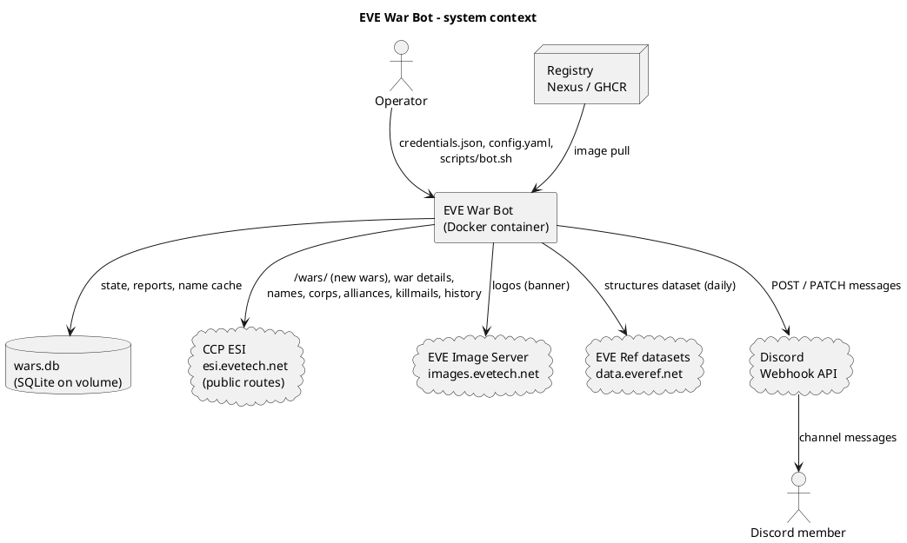
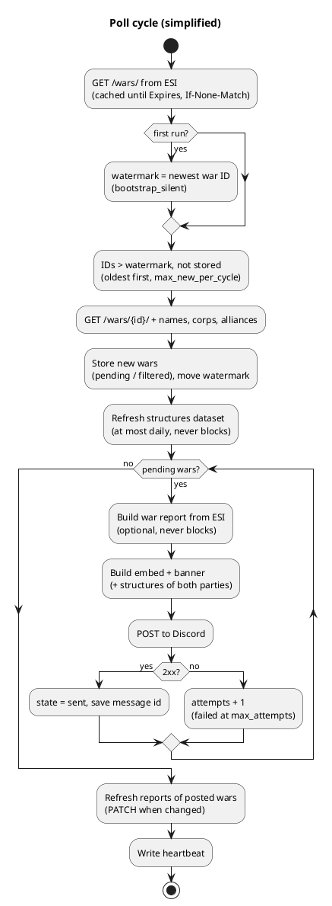
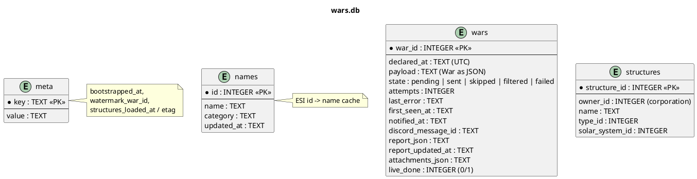

# FRD — Functional Requirements Document

| | |
|---|---|
| **Product** | EVE War Bot 2.1.0 |
| **Owner** | Andrii Kunitsyn (Business Analyst) |
| **Status** | Draft for review |
| **Updated** | 2026-10-27 (2.1.0) |
| **Related** | [Vision](01-Vision.md) · [User stories](03-User-Stories.md) · [Acceptance testing](04-Acceptance-Testing.md) |

[Home](Home.md) › FRD

---

## 1. Purpose and scope

This document describes **what** the EVE War Bot does, as epics and features, plus the rules, quality requirements and interfaces that apply to all of them. Each feature is detailed by [user stories](03-User-Stories.md) with acceptance criteria. The *why* is in the [Vision](01-Vision.md). The *how* is in the technical [README](../../README.md).

## 2. System context

## 3. Actors

| Actor | Description |
|---|---|
| Discord member | Reads war messages in the channel |
| Discord server admin | Creates the webhook, chooses the channel, role and filters |
| Operator / server owner | Installs, configures and runs the bot on a Linux server |
| Developer | Changes the code, publishes images |
| Scheduler (internal) | Bot loop: poll cycle every `poll_interval_min`, report update every `update_interval_min` |

## 4. Process overview

## 5. Epics and features

Priorities use MoSCoW. Every feature is traced to its stories.

### EP-01 War detection

**Goal:** Find every new war declaration in CCP's official API (ESI) reliably and exactly once.

| Feature | Priority | Description | Stories |
|---|---|---|---|
| **F-01.1** Scheduled polling of ESI | Must | Read `GET /wars/` every `poll_interval_min` minutes, re-using ESI's cache until `Expires`. | [US-01.01](user-stories/US-01.01.md) |
| **F-01.2** War details from ESI | Must | For each new war: declared time, status, both parties (name, ticker, type, members, corporations) from ESI. | [US-01.02](user-stories/US-01.02.md), [US-01.03](user-stories/US-01.03.md) |
| **F-01.3** New-war detection & de-duplication | Must | Watermark on the war ID plus the database: a war is notified at most once, also across restarts. | [US-01.04](user-stories/US-01.04.md) |
| **F-01.4** Silent bootstrap & upgrade | Must | The first run posts nothing; a 1.x database continues after its newest known war. | [US-01.05](user-stories/US-01.05.md), [US-01.08](user-stories/US-01.08.md) |
| **F-01.5** ESI compliance & resilience | Must | Version-less routes, compatibility date, User-Agent with contact, Expires/ETag caching, rate and error limits; ESI errors never stop the service. | [US-01.06](user-stories/US-01.06.md), [US-01.07](user-stories/US-01.07.md) |

### EP-02 Discord delivery

**Goal:** Deliver each new war to the Discord channel, reliably and within rate limits.

| Feature | Priority | Description | Stories |
|---|---|---|---|
| **F-02.1** Webhook posting | Must | Post via a Discord webhook; store the Discord message ID. | [US-02.01](user-stories/US-02.01.md) |
| **F-02.2** Rate limits, retries, webhook errors | Must | Honour 429/`retry_after`, retry 5xx, stop clearly on an invalid webhook. | [US-02.02](user-stories/US-02.02.md), [US-02.03](user-stories/US-02.03.md) |
| **F-02.3** Role mention | Could | Optionally ping one Discord role per message. | [US-02.04](user-stories/US-02.04.md) |
| **F-02.4** Batching | Could | Up to 10 wars per message. | [US-02.05](user-stories/US-02.05.md) |
| **F-02.5** Filters | Should | Only wars of watched entities / statuses / minimum defender size. | [US-02.06](user-stories/US-02.06.md) |

### EP-03 Rich message content

**Goal:** Make each notification readable at a glance: logos, banner, colours, links, structures of both sides.

| Feature | Priority | Description | Stories |
|---|---|---|---|
| **F-03.1** Logos | Must | High-resolution alliance/corporation logos from the EVE Image Server (entity ID from ESI). | [US-03.01](user-stories/US-03.01.md) |
| **F-03.2** VS banner | Could | Generated 'Aggressor VS Defender' PNG attached to the message. | [US-03.02](user-stories/US-03.02.md) |
| **F-03.3** Colours, times, links | Should | Status colour, local-time timestamps, links to zKillboard and DOTLAN (links only). | [US-03.03](user-stories/US-03.03.md) |
| **F-03.4** Structures of each party | Should | Publicly known Upwell structures of each side (corporation war: the corporation; alliance war: every member corporation) from the daily EVE Ref structures dataset. | [US-03.04](user-stories/US-03.04.md), [US-03.05](user-stories/US-03.05.md), [US-03.06](user-stories/US-03.06.md) |

### EP-04 War report & live updates

**Goal:** Show a full war report (like DOTLAN's war page) and keep it current while the war runs.

| Feature | Priority | Description | Stories |
|---|---|---|---|
| **F-04.1** War report from ESI | Should | Timeline, score per side, efficiency, tickers, defender allies. | [US-04.01](user-stories/US-04.01.md), [US-04.05](user-stories/US-04.05.md) |
| **F-04.2** Kills & hot systems | Should | Newest kills (ship, victim, system) and the systems with most kills. | [US-04.02](user-stories/US-04.02.md) |
| **F-04.3** Live message updates | Should | Edit the posted message when the report changes. | [US-04.03](user-stories/US-04.03.md) |
| **F-04.4** End of war | Should | Final update when the war is finished or retracted; then stop. | [US-04.04](user-stories/US-04.04.md) |

### EP-05 Configuration & secrets

**Goal:** Let an operator configure the bot safely without touching code.

| Feature | Priority | Description | Stories |
|---|---|---|---|
| **F-05.1** Credentials file | Must | Secrets only in `config/credentials.json` (template, validation, never in git/image). | [US-05.01](user-stories/US-05.01.md) |
| **F-05.2** Settings file | Must | Behaviour in `config/config.yaml`. | [US-05.02](user-stories/US-05.02.md) |
| **F-05.3** Dry run | Should | Show what would be posted without posting or changing stored state. | [US-05.03](user-stories/US-05.03.md) |

### EP-06 Deployment & operations

**Goal:** Run unattended in Docker on a small or shared Linux server; easy to install, update, revert.

| Feature | Priority | Description | Stories |
|---|---|---|---|
| **F-06.1** Container runtime | Must | Docker image, non-root, read-only, memory/CPU limits. | [US-06.01](user-stories/US-06.01.md) |
| **F-06.2** Persistent storage | Must | SQLite on a Docker volume. | [US-06.02](user-stories/US-06.02.md) |
| **F-06.3** Health & logs | Should | Health check, log rotation. | [US-06.03](user-stories/US-06.03.md) |
| **F-06.4** Operations helper | Should | `scripts/bot.sh` for everyday tasks. | [US-06.04](user-stories/US-06.04.md) |
| **F-06.5** Server preparation & revert | Should | Safe setup on existing servers; revert of earlier setup runs. | [US-06.05](user-stories/US-06.05.md), [US-06.06](user-stories/US-06.06.md) |
| **F-06.6** Registry delivery | Could | Publish to Nexus; one-command install on the server. | [US-06.07](user-stories/US-06.07.md), [US-06.08](user-stories/US-06.08.md) |
| **F-06.7** Continuous integration | Could | Tests and image build on GitHub Actions. | [US-06.09](user-stories/US-06.09.md) |

### EP-07 Reporting & statistics

**Goal:** Provide numbers about war activity and about the bot's own performance.

| Feature | Priority | Description | Stories |
|---|---|---|---|
| **F-07.1** 1st-of-month war statistics | Should | Wars declared on the 1st day of each month, from ESI history and the bot database. | [US-07.01](user-stories/US-07.01.md) |
| **F-07.2** KPI report | Could | Bot KPIs (latency, delivery, duplicates) from the database. | [US-07.02](user-stories/US-07.02.md) |

## 6. Business rules

| ID | Rule |
|---|---|
| BR-01 | A war is identified by its CCP war ID from ESI (the same ID DOTLAN and zKillboard use). |
| BR-02 | A war is posted **at most once**. Later changes are shown by editing the same message. |
| BR-03 | On the first run (`bootstrap_silent: true`), the newest war ID becomes the watermark; wars at or below it are never posted. A 1.x database continues after its highest stored war ID. |
| BR-04 | Wars that don't match the filters are stored as `filtered` and are not posted later, even if the filters change. |
| BR-05 | A war whose posting failed `max_attempts` times (default 5) is marked `failed` and not retried. |
| BR-06 | The war report is optional: a missing report never stops or delays a post. |
| BR-07 | Live updates stop when the war is finished or retracted (after one final edit), when the message has been deleted, or after `track_days` (default 7). |
| BR-08 | All times are EVE time (UTC). In messages, Discord shows them in each reader's own time zone. |
| BR-09 | A dry run never posts and never changes the real database. |
| BR-11 | Structures of a party: corporation war → structures owned by that corporation; alliance war → structures owned by every current member corporation. Only publicly known structures are shown; the field is optional and never delays a post. |
| BR-10 | 1st-of-month statistics count wars **declared** between 00:00:00 and 23:59:59 UTC on the 1st day of the month. |

## 7. Non-functional requirements

| ID | Category | Requirement | Verified by |
|---|---|---|---|
| NFR-01 | Performance | A new war is posted ≤ 75 min (P95) after its declaration: ESI caches `/wars/` for up to 1 h ([K-1](01-Vision.md#5-kpis)) | [MT-R-03](07-Manual-Test-Scenarios.md#mt-r-03) |
| NFR-02 | Reliability | No duplicate messages; pending posts survive restarts | `test_bootstrap_silent_then_only_new`, [MT-S-05](07-Manual-Test-Scenarios.md#mt-s-05) |
| NFR-03 | Availability | Health check reports *unhealthy* after 2 × interval + 5 min without a successful cycle | [MT-R-19](07-Manual-Test-Scenarios.md#mt-r-19) |
| NFR-04 | Resources | Container memory ≤ 256 MiB hard limit (typical 45–80 MiB), ≤ 0.5 CPU, ≤ 64 processes | [MT-R-18](07-Manual-Test-Scenarios.md#mt-r-18) |
| NFR-05 | Security | Secrets only in `config/credentials.json`, mounted read-only; never in the image, git or logs | [MT-R-04](07-Manual-Test-Scenarios.md#mt-r-04), review |
| NFR-06 | Security | Container: non-root (uid 10001), read-only root filesystem, `cap_drop: ALL`, `no-new-privileges`, no published ports | [MT-R-18](07-Manual-Test-Scenarios.md#mt-r-18) |
| NFR-07 | Host safety | Scripts never change the firewall, ports, environment variables or sysctl, and never restart unrelated services ([K-9](01-Vision.md#5-kpis)) | [MT-R-21](07-Manual-Test-Scenarios.md#mt-r-21) |
| NFR-08 | Fair use | ESI rules followed: version-less routes + `X-Compatibility-Date`, `User-Agent` with app/version/contact/URL, no request before `Expires`, `If-None-Match`/304, 429 `Retry-After`, error limit (420) and token buckets honoured. Discord ≥ 2 s between posts, 429 honoured | Review, [MT-R-29](07-Manual-Test-Scenarios.md#mt-r-29) |
| NFR-09 | Portability | Runs on Docker Engine with Compose v2 (including older 2.x versions), on Ubuntu 20.04/22.04/24.04 and Docker Desktop (Windows) | Field: Windows Docker Desktop ✔, Ubuntu 22.04 server ✔ |
| NFR-10 | Maintainability | Automated tests run on every push (GitHub Actions); ESI access isolated in `app/esi.py` and `app/source.py` | [Integration tests](05-Integration-Tests.md) |
| NFR-11 | Operability | Every routine task is one `scripts/bot.sh` command; configuration errors name the field and the fix | [MT-R-20](07-Manual-Test-Scenarios.md#mt-r-20) |
| NFR-12 | Logging | Logs on stdout, rotated at 3 × 5 MB; no secrets in logs | Review |

## 8. Constraints

| ID | Constraint |
|---|---|
| C-01 | *Since 2.0* new wars come only from ESI `GET /wars/` (newest 2000 IDs, cached up to 1 h). 1.x parsed the DOTLAN HTML list; that was dropped to depend only on CCP's official API. |
| C-02 | DOTLAN, zKillboard and Adam4EVE are only **linked** in messages; the bot never reads them. |
| C-03 | ESI does not return an ISK value per killmail. Only per-side totals (`isk_destroyed`) are used. |
| C-04 | The target server is a small **shared** VM (1 GB RAM, 2 vCPU) that already runs other web apps and has been in use for years. Setup must not assume a fresh server. |
| C-05 | *Lesson learned (1.3.0):* an earlier setup script enabled `ufw` (SSH only), changed `vm.swappiness`, ran `apt-get upgrade` and could hang on `cloud-init status --wait`. All of these have been removed, and `scripts/revert-setup.sh` undoes them ([US-06.06](user-stories/US-06.06.md)). |
| C-06 | Older Docker Compose versions only accept numeric `cpus` values, and mounting single files can go stale on Docker Desktop. The bot uses `cpus: 0.5` and mounts the whole `config/` folder. |
| C-08 | *Since 2.1* structures are **not** read from adam4eve.eu: its `robots.txt` disallows bots on the structure pages. The bot uses the public EVE Ref structures dataset (`data.everef.net/structures/`), which is built from ESI and includes a backfill from Adam4EVE and other sources. It contains only structures visible to outsiders; it is refreshed about daily, so new or destroyed structures can lag by a day. |
| C-07 | The bot only makes outgoing connections. Features that need incoming connections (slash commands, buttons) are out of scope. |

## 9. External interfaces

| Interface | Direction | Protocol / format | Used for | Feature |
|---|---|---|---|---|
| ESI `GET /wars/` | out | HTTPS, JSON, `Expires`/`ETag` | newest war IDs (detection) | F-01.1, F-01.3 |
| ESI `GET /wars/{id}/`, `/corporations/{id}/`, `/alliances/{id}/`, `/alliances/{id}/corporations/`, `POST /universe/names/` | out | HTTPS, JSON | war details, parties | F-01.2 |
| ESI `GET /wars/{id}/killmails/`, `/killmails/{id}/{hash}/`, `GET /wars/?max_war_id=` | out | HTTPS, JSON | war report, history statistics | F-04.x, F-07.1 |
| EVE Image Server `/alliances|corporations/{id}/logo` | out | HTTPS, PNG | logos, banner | F-03.1, F-03.2 |
| EVE Ref `GET data.everef.net/structures/structures-latest.v2.json` | out | HTTPS, JSON (streamed), `ETag`/`Last-Modified` | publicly known structures with owner, type, system | F-03.4 |
| ESI `GET /alliances/{id}/corporations/`, `POST /universe/names/` | out | HTTPS, JSON | member corporations of an alliance, type/system names | F-03.4 |
| Discord `POST {webhook}?wait=true`, `PATCH {webhook}/messages/{id}` | out | HTTPS, JSON or multipart | messages, live updates | F-02.x, F-04.3 |
| `config/credentials.json` | in | JSON | secrets | F-05.1 |
| `config/config.yaml` | in | YAML | settings | F-05.2 |
| `/data/wars.db` | internal | SQLite | state, reports, name cache | F-01.3, F-06.2 |
| Nexus / GHCR | out (push), in (pull) | Docker registry v2 | image delivery | F-06.6, F-06.7 |

## 10. Data model

## 11. Assumptions and open questions

| ID | Item | Owner | Status |
|---|---|---|---|
| A-01 | ESI `GET /wars/` lists every new war; war IDs only grow | Dev | Documented ESI behaviour; K-2 coverage measures it |
| A-02 | The default compatibility date `2025-08-26` is accepted by ESI | Dev | Check the start log on the server ([MT-R-31](07-Manual-Test-Scenarios.md#mt-r-31)) |
| Q-01 | Should the bot raise its compatibility date regularly (after reading the ESI changelog)? | PO / Dev | Open |
| Q-02 | Should war end / status changes also get a separate message (in addition to the edit)? | PO | Open |
| A-03 | The EVE Ref structures dataset stays publicly available and keeps its JSON shape (keyed by structure ID, with `owner_id`) | Dev | Planned contract test IT-P-05 |
| Q-04 | Should the bot also show structures of the defender's allies? | PO | Open |
| Q-03 | Should statistics also cover other days, or wars *ended* per month? | PO | Open |

## 12. Glossary

| Term | Meaning |
|---|---|
| War declaration | An aggressor corporation/alliance declares war on a defender; fighting starts about 24 h later |
| Mutual war | Both sides agreed to the war |
| Open for allies | The defender may accept allies |
| Webhook | Secret Discord URL; whatever is posted to it appears in the channel |
| Embed | Discord's rich message block (title, fields, images, colour) |
| ESI | EVE Swagger Interface, CCP's official API ([docs](https://developers.eveonline.com/docs/services/esi/overview/)) |
| Compatibility date | `X-Compatibility-Date` header: ESI answers with the API behaviour of that date |
| Watermark | Highest war ID the bot has processed; only higher IDs are new |
| Bootstrap | The bot's first run: it remembers the newest war ID and posts nothing |
| Live update | Editing an already posted message with a fresh war report |
