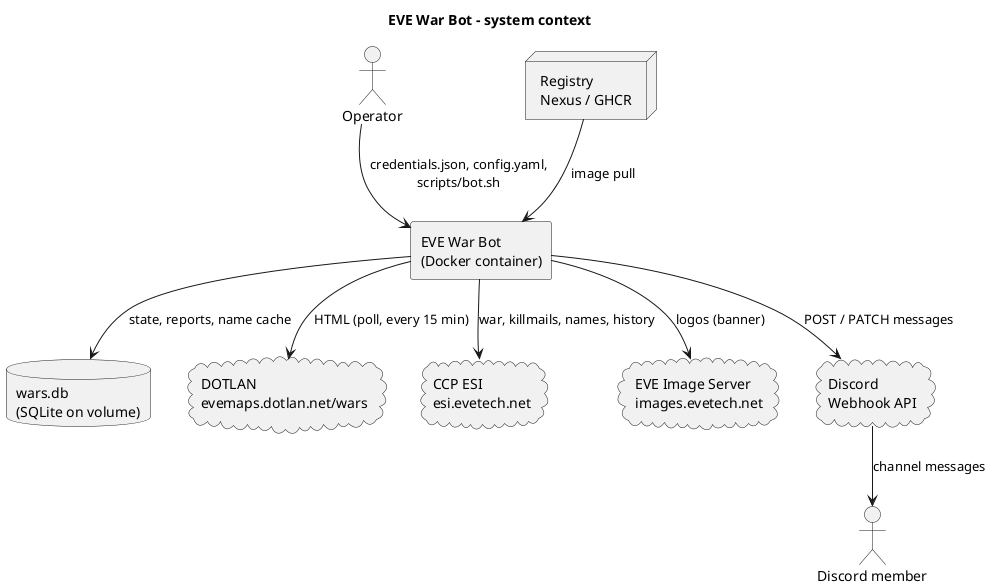
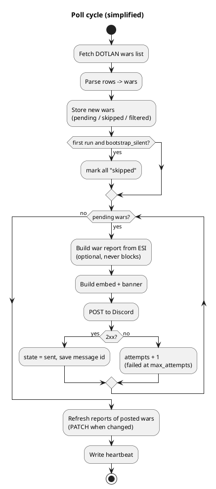
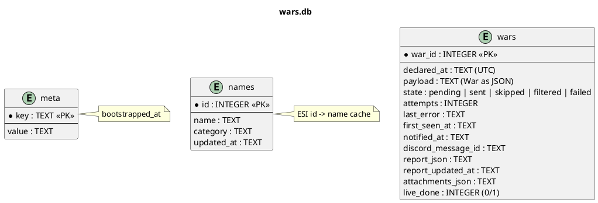

# FRD — Functional Requirements Document

| | |
|---|---|
| **Product** | EVE War Bot 1.3.0 |
| **Owner** | Andrii Kunitsyn (Business Analyst) |
| **Status** | Draft for review |
| **Updated** | 2026-10-24 |
| **Related** | [Vision](01-Vision.md) · [User stories](03-User-Stories.md) · [Acceptance testing](04-Acceptance-Testing.md) |

[Home](Home.md) › FRD

---

## 1. Purpose and scope

This document describes **what** the EVE War Bot does, as epics and features, plus the rules, quality requirements and interfaces that apply to all of them. Each feature is detailed by [user stories](03-User-Stories.md) with acceptance criteria. The *why* is in the [Vision](01-Vision.md). The *how* is in the technical [README](../../README.md).

## 2. System context

## 3. Actors

| Actor | Description |
|---|---|
| Discord member | Reads war messages in the channel |
| Discord server admin | Creates the webhook, chooses the channel, role and filters |
| Operator / server owner | Installs, configures and runs the bot on a Linux server |
| Developer | Changes the code, publishes images |
| Scheduler (internal) | Bot loop: poll cycle every `poll_interval_min`, report update every `update_interval_min` |

## 4. Process overview

## 5. Epics and features

Priorities use MoSCoW. Every feature is traced to its stories.

### EP-01 War detection

**Goal:** Find every new war declaration on DOTLAN reliably and exactly once.

| Feature | Priority | Description | Stories |
|---|---|---|---|
| **F-01.1** Scheduled polling | Must | Fetch the DOTLAN wars list every `poll_interval_min` minutes. | [US-01.01](user-stories/US-01.01.md) |
| **F-01.2** Wars table parsing | Must | Extract war ID, parties (name, type, entity ID, members), declared time, status. | [US-01.02](user-stories/US-01.02.md), [US-01.03](user-stories/US-01.03.md) |
| **F-01.3** New-war detection & de-duplication | Must | A war is notified at most once, also across restarts. | [US-01.04](user-stories/US-01.04.md) |
| **F-01.4** Silent bootstrap | Must | The first run stores the current list without posting it. | [US-01.05](user-stories/US-01.05.md) |
| **F-01.5** Robust parsing | Should | Broken rows or layout changes are logged and do not stop the service. | [US-01.06](user-stories/US-01.06.md) |

### EP-02 Discord delivery

**Goal:** Deliver each new war to the Discord channel, reliably and within rate limits.

| Feature | Priority | Description | Stories |
|---|---|---|---|
| **F-02.1** Webhook posting | Must | Post via a Discord webhook; store the Discord message ID. | [US-02.01](user-stories/US-02.01.md) |
| **F-02.2** Rate limits, retries, webhook errors | Must | Honour 429/`retry_after`, retry 5xx, stop clearly on an invalid webhook. | [US-02.02](user-stories/US-02.02.md), [US-02.03](user-stories/US-02.03.md) |
| **F-02.3** Role mention | Could | Optionally ping one Discord role per message. | [US-02.04](user-stories/US-02.04.md) |
| **F-02.4** Batching | Could | Up to 10 wars per message. | [US-02.05](user-stories/US-02.05.md) |
| **F-02.5** Filters | Should | Only wars of watched entities / statuses / minimum defender size. | [US-02.06](user-stories/US-02.06.md) |

### EP-03 Rich message content

**Goal:** Make each notification readable at a glance: logos, banner, colours, links.

| Feature | Priority | Description | Stories |
|---|---|---|---|
| **F-03.1** Logos | Must | High-resolution alliance/corporation logos from the EVE Image Server, DOTLAN fallback. | [US-03.01](user-stories/US-03.01.md) |
| **F-03.2** VS banner | Could | Generated 'Aggressor VS Defender' PNG attached to the message. | [US-03.02](user-stories/US-03.02.md) |
| **F-03.3** Colours, times, links | Should | Status colour, local-time timestamps, links to DOTLAN and zKillboard. | [US-03.03](user-stories/US-03.03.md) |

### EP-04 War report & live updates

**Goal:** Show the content of a DOTLAN war report and keep it current while the war runs.

| Feature | Priority | Description | Stories |
|---|---|---|---|
| **F-04.1** War report from ESI | Should | Timeline, score per side, efficiency, tickers, defender allies. | [US-04.01](user-stories/US-04.01.md), [US-04.05](user-stories/US-04.05.md) |
| **F-04.2** Kills & hot systems | Should | Newest kills (ship, victim, system) and the systems with most kills. | [US-04.02](user-stories/US-04.02.md) |
| **F-04.3** Live message updates | Should | Edit the posted message when the report changes. | [US-04.03](user-stories/US-04.03.md) |
| **F-04.4** End of war | Should | Final update when the war is finished or retracted; then stop. | [US-04.04](user-stories/US-04.04.md) |

### EP-05 Configuration & secrets

**Goal:** Let an operator configure the bot safely without touching code.

| Feature | Priority | Description | Stories |
|---|---|---|---|
| **F-05.1** Credentials file | Must | Secrets only in `config/credentials.json` (template, validation, never in git/image). | [US-05.01](user-stories/US-05.01.md) |
| **F-05.2** Settings file | Must | Behaviour in `config/config.yaml`. | [US-05.02](user-stories/US-05.02.md) |
| **F-05.3** Dry run | Should | Show what would be posted without posting or changing stored state. | [US-05.03](user-stories/US-05.03.md) |

### EP-06 Deployment & operations

**Goal:** Run unattended in Docker on a small or shared Linux server; easy to install, update, revert.

| Feature | Priority | Description | Stories |
|---|---|---|---|
| **F-06.1** Container runtime | Must | Docker image, non-root, read-only, memory/CPU limits. | [US-06.01](user-stories/US-06.01.md) |
| **F-06.2** Persistent storage | Must | SQLite on a Docker volume. | [US-06.02](user-stories/US-06.02.md) |
| **F-06.3** Health & logs | Should | Health check, log rotation. | [US-06.03](user-stories/US-06.03.md) |
| **F-06.4** Operations helper | Should | `scripts/bot.sh` for everyday tasks. | [US-06.04](user-stories/US-06.04.md) |
| **F-06.5** Server preparation & revert | Should | Safe setup on existing servers; revert of earlier setup runs. | [US-06.05](user-stories/US-06.05.md), [US-06.06](user-stories/US-06.06.md) |
| **F-06.6** Registry delivery | Could | Publish to Nexus; one-command install on the server. | [US-06.07](user-stories/US-06.07.md), [US-06.08](user-stories/US-06.08.md) |
| **F-06.7** Continuous integration | Could | Tests and image build on GitHub Actions. | [US-06.09](user-stories/US-06.09.md) |

### EP-07 Reporting & statistics

**Goal:** Provide numbers about war activity and about the bot's own performance.

| Feature | Priority | Description | Stories |
|---|---|---|---|
| **F-07.1** 1st-of-month war statistics | Should | Wars declared on the 1st day of each month, from ESI history and the bot database. | [US-07.01](user-stories/US-07.01.md) |
| **F-07.2** KPI report | Could | Bot KPIs (latency, delivery, duplicates) from the database. | [US-07.02](user-stories/US-07.02.md) |

## 6. Business rules

| ID | Rule |
|---|---|
| BR-01 | A war is identified by the DOTLAN war ID, which is the same as the CCP war ID. |
| BR-02 | A war is posted **at most once**. Later changes are shown by editing the same message. |
| BR-03 | On the first run (`bootstrap_silent: true`), all wars listed at that moment are stored as `skipped` and never posted. |
| BR-04 | Wars that don't match the filters are stored as `filtered` and are not posted later, even if the filters change. |
| BR-05 | A war whose posting failed `max_attempts` times (default 5) is marked `failed` and not retried. |
| BR-06 | The war report is optional: a missing report never stops or delays a post. |
| BR-07 | Live updates stop when the war is finished or retracted (after one final edit), when the message has been deleted, or after `track_days` (default 7). |
| BR-08 | All times are EVE time (UTC). In messages, Discord shows them in each reader's own time zone. |
| BR-09 | A dry run never posts and never changes the real database. |
| BR-10 | 1st-of-month statistics count wars **declared** between 00:00:00 and 23:59:59 UTC on the 1st day of the month. |

## 7. Non-functional requirements

| ID | Category | Requirement | Verified by |
|---|---|---|---|
| NFR-01 | Performance | A new war is posted ≤ 30 min (P95) after its declaration ([K-1](01-Vision.md#5-kpis)) | [MT-R-03](07-Manual-Test-Scenarios.md#mt-r-03) |
| NFR-02 | Reliability | No duplicate messages; pending posts survive restarts | `test_bootstrap_silent_then_only_new`, [MT-S-05](07-Manual-Test-Scenarios.md#mt-s-05) |
| NFR-03 | Availability | Health check reports *unhealthy* after 2 × interval + 5 min without a successful cycle | [MT-R-19](07-Manual-Test-Scenarios.md#mt-r-19) |
| NFR-04 | Resources | Container memory ≤ 256 MiB hard limit (typical 45–80 MiB), ≤ 0.5 CPU, ≤ 64 processes | [MT-R-18](07-Manual-Test-Scenarios.md#mt-r-18) |
| NFR-05 | Security | Secrets only in `config/credentials.json`, mounted read-only; never in the image, git or logs | [MT-R-04](07-Manual-Test-Scenarios.md#mt-r-04), review |
| NFR-06 | Security | Container: non-root (uid 10001), read-only root filesystem, `cap_drop: ALL`, `no-new-privileges`, no published ports | [MT-R-18](07-Manual-Test-Scenarios.md#mt-r-18) |
| NFR-07 | Host safety | Scripts never change the firewall, ports, environment variables or sysctl, and never restart unrelated services ([K-9](01-Vision.md#5-kpis)) | [MT-R-21](07-Manual-Test-Scenarios.md#mt-r-21) |
| NFR-08 | Fair use | DOTLAN polled ≥ 10 min apart, `User-Agent` with contact; Discord ≥ 2 s between posts, 429 honoured; ESI error limit honoured | Review, [MT-R-29](07-Manual-Test-Scenarios.md#mt-r-29) |
| NFR-09 | Portability | Runs on Docker Engine with Compose v2 (including older 2.x versions), on Ubuntu 20.04/22.04/24.04 and Docker Desktop (Windows) | Field: Windows Docker Desktop ✔, Ubuntu 22.04 server ✔ |
| NFR-10 | Maintainability | Automated tests run on every push (GitHub Actions); parser isolated in `app/scraper.py` | [Integration tests](05-Integration-Tests.md) |
| NFR-11 | Operability | Every routine task is one `scripts/bot.sh` command; configuration errors name the field and the fix | [MT-R-20](07-Manual-Test-Scenarios.md#mt-r-20) |
| NFR-12 | Logging | Logs on stdout, rotated at 3 × 5 MB; no secrets in logs | Review |

## 8. Constraints

| ID | Constraint |
|---|---|
| C-01 | DOTLAN has no public API for the wars list. The HTML page is parsed. |
| C-02 | DOTLAN `/war/{id}` pages are disallowed for bots by `robots.txt`. War report data comes from CCP ESI instead. |
| C-03 | ESI does not return an ISK value per killmail. Only per-side totals (`isk_destroyed`) are used. |
| C-04 | The target server is a small **shared** VM (1 GB RAM, 2 vCPU) that already runs other web apps and has been in use for years. Setup must not assume a fresh server. |
| C-05 | *Lesson learned (1.3.0):* an earlier setup script enabled `ufw` (SSH only), changed `vm.swappiness`, ran `apt-get upgrade` and could hang on `cloud-init status --wait`. All of these have been removed, and `scripts/revert-setup.sh` undoes them ([US-06.06](user-stories/US-06.06.md)). |
| C-06 | Older Docker Compose versions only accept numeric `cpus` values, and mounting single files can go stale on Docker Desktop. The bot uses `cpus: 0.5` and mounts the whole `config/` folder. |
| C-07 | The bot only makes outgoing connections. Features that need incoming connections (slash commands, buttons) are out of scope. |

## 9. External interfaces

| Interface | Direction | Protocol / format | Used for | Feature |
|---|---|---|---|---|
| DOTLAN `GET /wars[/view]` | out | HTTPS, HTML | wars list | F-01.1, F-01.2 |
| ESI `GET /wars/`, `/wars/{id}/`, `/wars/{id}/killmails/`, `/killmails/{id}/{hash}/`, `/alliances/{id}/`, `/corporations/{id}/`, `POST /universe/names/` | out | HTTPS, JSON | war report, history statistics | F-04.x, F-07.1 |
| EVE Image Server `/alliances|corporations/{id}/logo` | out | HTTPS, PNG | logos, banner | F-03.1, F-03.2 |
| Discord `POST {webhook}?wait=true`, `PATCH {webhook}/messages/{id}` | out | HTTPS, JSON or multipart | messages, live updates | F-02.x, F-04.3 |
| `config/credentials.json` | in | JSON | secrets | F-05.1 |
| `config/config.yaml` | in | YAML | settings | F-05.2 |
| `/data/wars.db` | internal | SQLite | state, reports, name cache | F-01.3, F-06.2 |
| Nexus / GHCR | out (push), in (pull) | Docker registry v2 | image delivery | F-06.6, F-06.7 |

## 10. Data model

## 11. Assumptions and open questions

| ID | Item | Owner | Status |
|---|---|---|---|
| A-01 | DOTLAN war IDs are the same as CCP ESI war IDs | Dev | Assumed; confirm with one real war ([MT-R-13](07-Manual-Test-Scenarios.md#mt-r-13)) |
| A-02 | The DOTLAN active-wars list contains every new war within one poll interval | PO | Measured by K-2 coverage |
| Q-01 | Is polling DOTLAN every 15 minutes acceptable to the site owner? | PO | Open |
| Q-02 | Should war end / status changes also get a separate message (in addition to the edit)? | PO | Open |
| Q-03 | Should statistics also cover other days, or wars *ended* per month? | PO | Open |

## 12. Glossary

| Term | Meaning |
|---|---|
| War declaration | An aggressor corporation/alliance declares war on a defender; fighting starts about 24 h later |
| Mutual war | Both sides agreed to the war |
| Open for allies | The defender may accept allies |
| Webhook | Secret Discord URL; whatever is posted to it appears in the channel |
| Embed | Discord's rich message block (title, fields, images, colour) |
| ESI | EVE Swagger Interface, CCP's official API |
| Bootstrap | The bot's first run, which stores existing wars without posting them |
| Live update | Editing an already posted message with a fresh war report |
