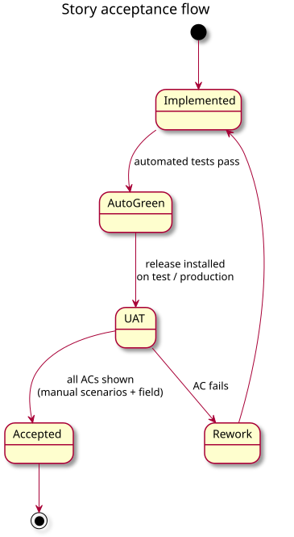
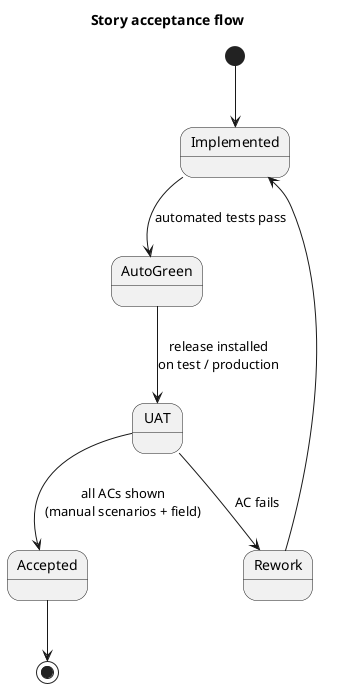

# Acceptance testing

[Home](Home.md) › Acceptance testing

| | |
|---|---|
| **Scope** | User acceptance of release 2.1.0 against the [user stories](03-User-Stories.md) |
| **Product owner (accepts)** | Andrii Kunitsyn |
| **Updated** | 2026-10-27 (2.1.0) |

---

## 1. Approach

A story is **accepted** when all of its acceptance criteria (Given / When / Then on the story page) are shown to hold on a real installation (the *field*). Evidence comes from three sources:

1. **Automated tests** ([Integration tests](05-Integration-Tests.md)): run on every push. A green run is required before UAT, but it is not acceptance on its own.
2. **Manual test scenarios** ([Manual tests](07-Manual-Test-Scenarios.md)): executed on the production server or a test server, results recorded in the scenario's *Result* line.
3. **Field observation**: logs or messages from normal operation, e.g. the bootstrap log on the server.

PlantUML source

## 2. Entry and exit criteria

| | Criteria |
|---|---|
| **Entry** | All automated tests green · release installed with `bash scripts/bot.sh start` · `credentials.json` points to a **test channel** (or production, if agreed) · [sanity suite](07-Manual-Test-Scenarios.md#2-sanity-suite) passed |
| **Exit** | Every *Must* story accepted · no open defect of severity *High* · *Should*/*Could* stories accepted or explicitly deferred by the PO · results recorded on this page |
| **Suspend** | Sanity suite fails · the bot affects other apps on the server (stop immediately; see [US-06.06](user-stories/US-06.06.md)) |

## 3. Current state

- Acceptance criteria in total: **86**
- **Accepted (field):** 2 · **Ready for UAT (automated + manual):** 25 · **Ready for UAT (manual only):** 11 · **Not started:** 1

## 4. Acceptance matrix

*Field*: ✔ verified · ◐ partly or simulated · — pending. Click a story for its criteria.

### EP-01 War detection

| Story | ACs | Automated | Manual | Field | Acceptance |
|---|---:|---|---|---|---|
| [US-01.01](user-stories/US-01.01.md) Scheduled polling of ESI for new wars | 3 | 1 | [MT-S-06](07-Manual-Test-Scenarios.md#mt-s-06), [MT-R-03](07-Manual-Test-Scenarios.md#mt-r-03) | — | Ready for UAT |
| [US-01.02](user-stories/US-01.02.md) War details from ESI | 3 | 2 | [MT-S-02](07-Manual-Test-Scenarios.md#mt-s-02), [MT-R-02](07-Manual-Test-Scenarios.md#mt-r-02) | — | Ready for UAT |
| [US-01.03](user-stories/US-01.03.md) Use full entity names | 1 | 1 | [MT-R-02](07-Manual-Test-Scenarios.md#mt-r-02) | — | Ready for UAT |
| [US-01.04](user-stories/US-01.04.md) Notify each war only once | 3 | 2 | [MT-S-05](07-Manual-Test-Scenarios.md#mt-s-05), [MT-R-03](07-Manual-Test-Scenarios.md#mt-r-03) | — | Ready for UAT |
| [US-01.05](user-stories/US-01.05.md) Silent first run | 2 | 1 | [MT-R-01](07-Manual-Test-Scenarios.md#mt-r-01) | — | Ready for UAT |
| [US-01.06](user-stories/US-01.06.md) Survive ESI errors | 3 | 3 | [MT-R-30](07-Manual-Test-Scenarios.md#mt-r-30) | — | Ready for UAT |
| [US-01.07](user-stories/US-01.07.md) Follow the ESI rules | 3 | 4 | [MT-R-30](07-Manual-Test-Scenarios.md#mt-r-30), [MT-R-31](07-Manual-Test-Scenarios.md#mt-r-31) | — | Ready for UAT |
| [US-01.08](user-stories/US-01.08.md) Upgrade from 1.x without old posts | 2 | 3 | [MT-R-32](07-Manual-Test-Scenarios.md#mt-r-32) | — | Ready for UAT |

### EP-02 Discord delivery

| Story | ACs | Automated | Manual | Field | Acceptance |
|---|---:|---|---|---|---|
| [US-02.01](user-stories/US-02.01.md) Post a new war to Discord | 2 | 2 | [MT-S-04](07-Manual-Test-Scenarios.md#mt-s-04), [MT-R-03](07-Manual-Test-Scenarios.md#mt-r-03) | — | Ready for UAT |
| [US-02.02](user-stories/US-02.02.md) Respect Discord rate limits and retry | 3 | — | [MT-R-29](07-Manual-Test-Scenarios.md#mt-r-29) | — | Ready for UAT (manual only) |
| [US-02.03](user-stories/US-02.03.md) Detect an invalid webhook | 1 | — | [MT-R-07](07-Manual-Test-Scenarios.md#mt-r-07) | — | Ready for UAT (manual only) |
| [US-02.04](user-stories/US-02.04.md) Ping a role for new wars | 2 | — | [MT-R-08](07-Manual-Test-Scenarios.md#mt-r-08) | — | Ready for UAT (manual only) |
| [US-02.05](user-stories/US-02.05.md) Several wars in one message | 1 | 1 | [MT-R-09](07-Manual-Test-Scenarios.md#mt-r-09) | — | Ready for UAT |
| [US-02.06](user-stories/US-02.06.md) Filter which wars are posted | 3 | 2 | [MT-R-10](07-Manual-Test-Scenarios.md#mt-r-10) | — | Ready for UAT |

### EP-03 Rich message content

| Story | ACs | Automated | Manual | Field | Acceptance |
|---|---:|---|---|---|---|
| [US-03.01](user-stories/US-03.01.md) Show alliance/corporation logos | 2 | 1 | [MT-S-04](07-Manual-Test-Scenarios.md#mt-s-04), [MT-R-11](07-Manual-Test-Scenarios.md#mt-r-11) | — | Ready for UAT |
| [US-03.02](user-stories/US-03.02.md) Attach a VS banner | 2 | 1 | [MT-S-04](07-Manual-Test-Scenarios.md#mt-s-04), [MT-R-11](07-Manual-Test-Scenarios.md#mt-r-11) | — | Ready for UAT |
| [US-03.03](user-stories/US-03.03.md) Colours, local times and links | 2 | 3 | [MT-S-04](07-Manual-Test-Scenarios.md#mt-s-04), [MT-R-12](07-Manual-Test-Scenarios.md#mt-r-12) | — | Ready for UAT |
| [US-03.04](user-stories/US-03.04.md) Structures of a corporation in a corporation war | 4 | 3 | [MT-R-33](07-Manual-Test-Scenarios.md#mt-r-33) | — | Ready for UAT |
| [US-03.05](user-stories/US-03.05.md) Structures of all member corporations in an alliance war | 2 | 3 | [MT-R-34](07-Manual-Test-Scenarios.md#mt-r-34) | — | Ready for UAT |
| [US-03.06](user-stories/US-03.06.md) Daily structures dataset, never blocking a post | 3 | 3 | [MT-R-33](07-Manual-Test-Scenarios.md#mt-r-33), [MT-R-35](07-Manual-Test-Scenarios.md#mt-r-35) | — | Ready for UAT |

### EP-04 War report & live updates

| Story | ACs | Automated | Manual | Field | Acceptance |
|---|---:|---|---|---|---|
| [US-04.01](user-stories/US-04.01.md) War report: timeline, score, allies | 2 | 2 | [MT-S-04](07-Manual-Test-Scenarios.md#mt-s-04), [MT-R-13](07-Manual-Test-Scenarios.md#mt-r-13) | — | Ready for UAT |
| [US-04.02](user-stories/US-04.02.md) Recent kills and hot systems | 1 | 1 | [MT-R-13](07-Manual-Test-Scenarios.md#mt-r-13) | — | Ready for UAT |
| [US-04.03](user-stories/US-04.03.md) Live updates of the posted message | 3 | 1 | [MT-R-14](07-Manual-Test-Scenarios.md#mt-r-14) | — | Ready for UAT |
| [US-04.04](user-stories/US-04.04.md) Final state when a war ends | 2 | 1 | [MT-R-15](07-Manual-Test-Scenarios.md#mt-r-15) | — | Ready for UAT |
| [US-04.05](user-stories/US-04.05.md) Post even when ESI is down | 1 | — | [MT-R-16](07-Manual-Test-Scenarios.md#mt-r-16) | ◐ | Ready for UAT (manual only) |

### EP-05 Configuration & secrets

| Story | ACs | Automated | Manual | Field | Acceptance |
|---|---:|---|---|---|---|
| [US-05.01](user-stories/US-05.01.md) Credentials in a JSON file with validation | 3 | 2 | [MT-S-01](07-Manual-Test-Scenarios.md#mt-s-01), [MT-R-04](07-Manual-Test-Scenarios.md#mt-r-04), [MT-R-05](07-Manual-Test-Scenarios.md#mt-r-05), [MT-R-06](07-Manual-Test-Scenarios.md#mt-r-06) | ✔ | **Accepted (field)** |
| [US-05.02](user-stories/US-05.02.md) Settings in a YAML file | 2 | 2 | [MT-R-27](07-Manual-Test-Scenarios.md#mt-r-27) | — | Ready for UAT |
| [US-05.03](user-stories/US-05.03.md) Dry run | 2 | 1 | [MT-S-02](07-Manual-Test-Scenarios.md#mt-s-02), [MT-R-28](07-Manual-Test-Scenarios.md#mt-r-28) | ✔ | **Accepted (field)** |

### EP-06 Deployment & operations

| Story | ACs | Automated | Manual | Field | Acceptance |
|---|---:|---|---|---|---|
| [US-06.01](user-stories/US-06.01.md) Run in a resource-limited, hardened container | 2 | — | [MT-S-03](07-Manual-Test-Scenarios.md#mt-s-03), [MT-R-18](07-Manual-Test-Scenarios.md#mt-r-18) | ◐ | Ready for UAT (manual only) |
| [US-06.02](user-stories/US-06.02.md) Keep state across restarts | 2 | 1 | [MT-S-05](07-Manual-Test-Scenarios.md#mt-s-05), [MT-R-17](07-Manual-Test-Scenarios.md#mt-r-17) | — | Ready for UAT |
| [US-06.03](user-stories/US-06.03.md) Health check and log rotation | 2 | — | [MT-S-03](07-Manual-Test-Scenarios.md#mt-s-03), [MT-R-19](07-Manual-Test-Scenarios.md#mt-r-19) | — | Ready for UAT (manual only) |
| [US-06.04](user-stories/US-06.04.md) Everyday operations with one script | 2 | — | [MT-R-05](07-Manual-Test-Scenarios.md#mt-r-05), [MT-R-20](07-Manual-Test-Scenarios.md#mt-r-20) | ◐ | Ready for UAT (manual only) |
| [US-06.05](user-stories/US-06.05.md) Safe server setup on an existing server | 3 | — | [MT-R-21](07-Manual-Test-Scenarios.md#mt-r-21) | — | Ready for UAT (manual only) |
| [US-06.06](user-stories/US-06.06.md) Revert an earlier setup run | 3 | — | [MT-R-22](07-Manual-Test-Scenarios.md#mt-r-22) | — | Ready for UAT (manual only) |
| [US-06.07](user-stories/US-06.07.md) Publish the image to Nexus | 1 | — | [MT-R-23](07-Manual-Test-Scenarios.md#mt-r-23) | — | Ready for UAT (manual only) |
| [US-06.08](user-stories/US-06.08.md) One-command install from the image | 2 | 2 | [MT-R-23](07-Manual-Test-Scenarios.md#mt-r-23), [MT-R-24](07-Manual-Test-Scenarios.md#mt-r-24) | — | Ready for UAT |
| [US-06.09](user-stories/US-06.09.md) Continuous integration | 2 | — | [MT-R-25](07-Manual-Test-Scenarios.md#mt-r-25) | — | Ready for UAT (manual only) |

### EP-07 Reporting & statistics

| Story | ACs | Automated | Manual | Field | Acceptance |
|---|---:|---|---|---|---|
| [US-07.01](user-stories/US-07.01.md) Statistics of wars on the 1st day of each month | 3 | 2 | [MT-R-26](07-Manual-Test-Scenarios.md#mt-r-26) | — | Ready for UAT |
| [US-07.02](user-stories/US-07.02.md) KPI report from the bot database | 1 | — | — | — | Not started |

## 5. Field evidence so far

The evidence below was collected with **1.3** (DOTLAN source). 2.0 replaces the war source with ESI, so the EP-01 stories need field evidence again; the other epics are unchanged.

| Date | Where | Observation | Stories |
|---|---|---|---|
| 2026-10-23 | Windows PC, Docker Desktop | Config validation (empty or folder `credentials.json` → clear error), dry run with `[DRY RUN] POST` lines | [US-05.01](user-stories/US-05.01.md), [US-05.03](user-stories/US-05.03.md) |
| 2026-10-23 | Ubuntu 22.04 server (shared) | `eve-war-bot 1.3.0 started`, `Bootstrap: stored 61 existing wars silently`, `Parsed 61 wars, 61 new.` | [US-01.01](user-stories/US-01.01.md), [US-01.02](user-stories/US-01.02.md), [US-01.05](user-stories/US-01.05.md), [US-06.01](user-stories/US-06.01.md) |
| 2026-10-23 | Simulated (ESI unreachable) | All wars posted without report, warning logged | [US-04.05](user-stories/US-04.05.md) |
| 2026-10-23 | Issues found in the field and fixed | Compose `cpus` type, stale single-file mounts, setup script side effects / hang | [US-06.01](user-stories/US-06.01.md), [US-06.05](user-stories/US-06.05.md) |

## 6. Defects found during acceptance

| ID | Found | Severity | Description | Fix | Status |
|---|---|---|---|---|---|
| DEF-01 | 2026-10-23 | High | Setup script enabled `ufw` (SSH only), which can block other web apps on a shared server | Firewall step removed; revert script | Fixed in 1.3.0 |
| DEF-02 | 2026-10-23 | Medium | Setup script changed `vm.swappiness` and exported variables | Removed | Fixed |
| DEF-03 | 2026-10-23 | High | Setup script could hang forever on `cloud-init status --wait` on long-running servers | Removed; progress output while waiting for apt | Fixed |
| DEF-04 | 2026-10-23 | Medium | `cpus: "0.5"` rejected by older Docker Compose | `cpus: 0.5` | Fixed |
| DEF-05 | 2026-10-23 | Medium | Docker created a `credentials.json` **folder**; stale single-file mount on Docker Desktop | Mount whole `config/` folder; clear error message | Fixed |
| DEF-07 | 2026-10-24 | Medium | CI failed: `import app` not found with plain `pytest` | `pytest.ini` with `pythonpath = .` | Fixed |
| DEF-06 | 2026-10-23 | Low | `apt-get upgrade` 404 on outdated package lists (old setup script) | No upgrade by default; `--upgrade` runs `update` first | Fixed |

## 7. Sign-off

| Epic | Decision | Date | Signed by | Comment |
|---|---|---|---|---|
| EP-01 War detection | ☐ Accepted ☐ Deferred | | | |
| EP-02 Discord delivery | ☐ Accepted ☐ Deferred | | | |
| EP-03 Rich message content | ☐ Accepted ☐ Deferred | | | |
| EP-04 War report & live updates | ☐ Accepted ☐ Deferred | | | |
| EP-05 Configuration & secrets | ☐ Accepted ☐ Deferred | | | |
| EP-06 Deployment & operations | ☐ Accepted ☐ Deferred | | | |
| EP-07 Reporting & statistics | ☐ Accepted ☐ Deferred | | | |
