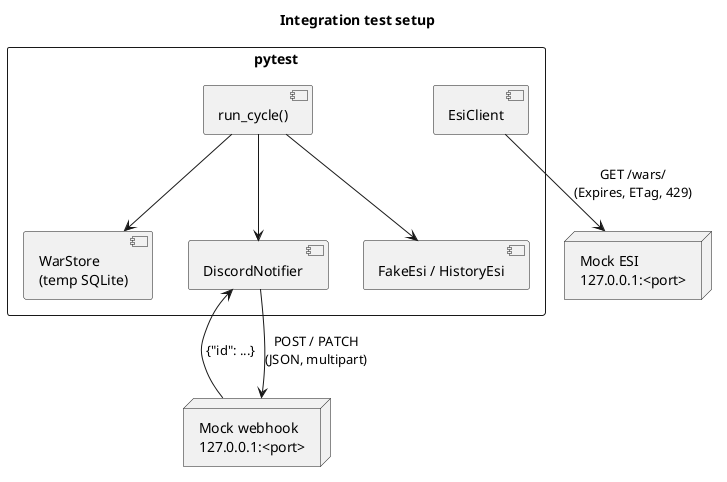

# Integration tests (automated)

[Home](Home.md) › Integration tests

| | |
|---|---|
| **Test code** | `tests/test_bot.py` (fake ESI class, mock ESI HTTP server, mock Discord server) |
| **Runs** | locally with `pytest -q` and on every push / PR (GitHub Actions `test-and-build`) |
| **Updated** | 2026-10-24 (2.0.0) |

---

## 1. Test levels

| Level | What is real | What is replaced | Count |
|---|---|---|---:|
| Unit | War source mapping, embeds, report builder, config loader, User-Agent, statistics algorithm | ESI (fake class), files | 11 |
| Integration | Full poll cycle: ESI source → SQLite store → embed builder → HTTP client → **local mock Discord webhook server**; **real HTTP to a local mock ESI server** for caching, headers and 429; `install` with a real bundle folder | ESI (fake class or local HTTP server), Discord (local HTTP server) | 14 |
| Contract / end-to-end | — (planned, see §5) | — | 0 |



## 2. How to run

```bash
pip install -r requirements.txt pytest
pytest -q                      # all tests
pytest -q -k live_update       # one test
```

Expected: **25 passed**. In CI, the image is only built and pushed when all tests pass.

## 3. Test catalogue

| # | Test | Type | Stories | Proves |
|---:|---|---|---|---|
| 1 | <a id="test_source_builds_war_from_esi"></a>`test_source_builds_war_from_esi` | Unit | [US-01.02](user-stories/US-01.02.md), [US-01.03](user-stories/US-01.03.md), [US-01.06](user-stories/US-01.06.md) | names, tickers, members (corp, small alliance), corporations count, unknown members for big alliances, status mapping, DOTLAN links, 404 → None |
| 2 | <a id="test_bootstrap_silent_then_only_new_and_no_repost_after_restart"></a>`test_bootstrap_silent_then_only_new_and_no_repost_after_restart` | Integration | [US-01.04](user-stories/US-01.04.md), [US-01.05](user-stories/US-01.05.md), [US-02.01](user-stories/US-02.01.md), [US-03.01](user-stories/US-03.01.md), [US-03.03](user-stories/US-03.03.md), [US-06.02](user-stories/US-06.02.md) | watermark bootstrap, only the new war posted, no re-post after two restarts, old wars never read in detail, logo and zKillboard link |
| 3 | <a id="test_non_silent_first_run_posts_all_and_filters"></a>`test_non_silent_first_run_posts_all_and_filters` | Integration | [US-02.01](user-stories/US-02.01.md), [US-02.06](user-stories/US-02.06.md) | all listed wars posted, status filter stores `filtered` |
| 4 | <a id="test_min_defender_members_and_watch_list"></a>`test_min_defender_members_and_watch_list` | Integration | [US-02.06](user-stories/US-02.06.md) | watch list and minimum defender size; unknown size is not filtered |
| 5 | <a id="test_catch_up_in_portions"></a>`test_catch_up_in_portions` | Integration | [US-01.04](user-stories/US-01.04.md) | `max_new_per_cycle`, oldest first, rest next cycle |
| 6 | <a id="test_upgrade_from_1x_database_continues_after_known_wars"></a>`test_upgrade_from_1x_database_continues_after_known_wars` | Integration | [US-01.08](user-stories/US-01.08.md) | 1.x database: watermark from the highest stored ID, only newer wars posted |
| 7 | <a id="test_esi_error_on_details_retries_next_cycle"></a>`test_esi_error_on_details_retries_next_cycle` | Integration | [US-01.06](user-stories/US-01.06.md) | temporary ESI error stops at that war, retried next cycle |
| 8 | <a id="test_missing_war_is_marked_and_not_retried"></a>`test_missing_war_is_marked_and_not_retried` | Integration | [US-01.06](user-stories/US-01.06.md) | 404 war stored as `skipped`, requested once |
| 9 | <a id="test_banner_multipart"></a>`test_banner_multipart` | Integration | [US-02.05](user-stories/US-02.05.md), [US-03.02](user-stories/US-03.02.md) | 4 wars in one message, multipart upload with `attachment://` references |
| 10 | <a id="test_party_field_shows_members_and_corporations"></a>`test_party_field_shows_members_and_corporations` | Unit | [US-01.02](user-stories/US-01.02.md), [US-03.03](user-stories/US-03.03.md) | ticker, members, corporations in the embed; zKillboard links |
| 11 | <a id="test_build_report_and_embed"></a>`test_build_report_and_embed` | Unit | [US-04.01](user-stories/US-04.01.md), [US-04.02](user-stories/US-04.02.md), [US-03.03](user-stories/US-03.03.md) | score, tickers, allies, kills (newest first, side), hot systems, efficiency |
| 12 | <a id="test_report_before_war_start_has_no_kills"></a>`test_report_before_war_start_has_no_kills` | Unit | [US-04.01](user-stories/US-04.01.md) | no killmails before the war starts |
| 13 | <a id="test_live_update_edits_message"></a>`test_live_update_edits_message` | Integration | [US-04.03](user-stories/US-04.03.md), [US-04.04](user-stories/US-04.04.md) | PATCH on change, none when unchanged, final 'ended' edit, then stop |
| 14 | <a id="test_esi_headers_and_expires_cache"></a>`test_esi_headers_and_expires_cache` | Integration | [US-01.07](user-stories/US-01.07.md), [US-01.01](user-stories/US-01.01.md) | real HTTP to a mock ESI: version-less `/wars/`, `X-Compatibility-Date`, User-Agent, no request before `Expires` |
| 15 | <a id="test_esi_etag_304_after_expiry"></a>`test_esi_etag_304_after_expiry` | Integration | [US-01.07](user-stories/US-01.07.md) | `If-None-Match` after expiry, 304 re-uses cached data |
| 16 | <a id="test_esi_429_waits_retry_after"></a>`test_esi_429_waits_retry_after` | Integration | [US-01.07](user-stories/US-01.07.md) | 429 → waits `Retry-After`, then succeeds |
| 17 | <a id="test_user_agent_format"></a>`test_user_agent_format` | Unit | [US-01.07](user-stories/US-01.07.md) | `eve-war-bot/<v> (<contact>; +<repo>) python-requests/<v>` |
| 18 | <a id="test_config_new_and_legacy_keys"></a>`test_config_new_and_legacy_keys` | Unit | [US-05.02](user-stories/US-05.02.md), [US-01.08](user-stories/US-01.08.md) | new `source.*`/`esi.*` keys, 1.x `dotlan.*`/`report.esi_*` keys, defaults |
| 19 | <a id="test_credentials_bom_and_legacy_contact"></a>`test_credentials_bom_and_legacy_contact` | Unit | [US-05.01](user-stories/US-05.01.md), [US-01.08](user-stories/US-01.08.md) | Windows BOM accepted; `esi.contact` and 1.x `dotlan.contact` |
| 20 | <a id="test_credentials_folder_gives_clear_error"></a>`test_credentials_folder_gives_clear_error` | Unit | [US-05.01](user-stories/US-05.01.md) | folder instead of file → clear error |
| 21 | <a id="test_dry_run_never_touches_real_storage"></a>`test_dry_run_never_touches_real_storage` | Integration | [US-05.03](user-stories/US-05.03.md) | dry run uses a temporary database |
| 22 | <a id="test_install_unpacks_bundle_and_keeps_user_files"></a>`test_install_unpacks_bundle_and_keeps_user_files` | Integration | [US-06.08](user-stories/US-06.08.md) | bundle written, `.env` image ref, user files kept with `--force` |
| 23 | <a id="test_install_refuses_unwritable_or_missing_target"></a>`test_install_refuses_unwritable_or_missing_target` | Unit | [US-06.08](user-stories/US-06.08.md) | clear error for a missing target |
| 24 | <a id="test_stats_counts_wars_on_first_day_of_month"></a>`test_stats_counts_wars_on_first_day_of_month` | Unit | [US-07.01](user-stories/US-07.01.md) | binary search finds exactly the wars of each 1st day (checked against brute force) with < 400 API calls |
| 25 | <a id="test_stats_bot_columns_from_database"></a>`test_stats_bot_columns_from_database` | Unit | [US-07.01](user-stories/US-07.01.md) | seen/posted counts from the database, `—` before the bot started |

Stories with at least one automated test: **24 of 36**.
Stories without an automated test yet: [US-02.02](user-stories/US-02.02.md), [US-02.03](user-stories/US-02.03.md), [US-02.04](user-stories/US-02.04.md), [US-04.05](user-stories/US-04.05.md), [US-06.01](user-stories/US-06.01.md), [US-06.03](user-stories/US-06.03.md), [US-06.04](user-stories/US-06.04.md), [US-06.05](user-stories/US-06.05.md), [US-06.06](user-stories/US-06.06.md), [US-06.07](user-stories/US-06.07.md), [US-06.09](user-stories/US-06.09.md), [US-07.02](user-stories/US-07.02.md).

## 4. Coverage gaps

| Gap | Story | Missing | Proposed test |
|---|---|---|---|
| G-01 | [US-02.02](user-stories/US-02.02.md) | Discord 429 / 5xx handling has no automated test | Mock webhook returning 429 with `retry_after`, then 200; 500 twice, then 200. |
| G-02 | [US-02.03](user-stories/US-02.03.md) | Invalid webhook (401/404) → exit code 3 has no automated test | Mock webhook returning 404; assert exit 3 and unchanged attempts. |
| G-03 | [US-01.07](user-stories/US-01.07.md) | ESI error limit (420, `X-ESI-Error-Limit-*`) and low-token slow-down are not tested | Mock ESI returning 420 with reset header; `X-Ratelimit-Remaining` below 10 %. |
| G-04 | [US-02.04](user-stories/US-02.04.md) | Role mention / `allowed_mentions` has no automated test | Assert payload `content` and `allowed_mentions` with and without a role ID. |
| G-06 | [US-06.01](user-stories/US-06.01.md) | Container limits and hardening are not checked in CI | CI job: build image, `docker inspect` for user, read-only, memory/CPU. |

## 5. Planned integration / contract tests

| ID | Planned test | Stories |
|---|---|---|
| IT-P-01 | Contract test against live ESI (nightly, read-only): `/wars/`, `/wars/{id}/`, `/corporations/{id}/`, `/alliances/{id}/`, `/universe/names/`; checks fields and the compatibility date | [US-01.02](user-stories/US-01.02.md), [US-01.07](user-stories/US-01.07.md), [US-04.01](user-stories/US-04.01.md), [US-07.01](user-stories/US-07.01.md) |
| IT-P-02 | Discord sandbox channel: post, edit and delete a real message with banner | [US-02.01](user-stories/US-02.01.md), [US-03.02](user-stories/US-03.02.md), [US-04.03](user-stories/US-04.03.md) |
| IT-P-03 | Container smoke test in CI: build, `--check-config`, dry run, health check | [US-06.01](user-stories/US-06.01.md), [US-06.03](user-stories/US-06.03.md) |
| IT-P-04 | `setup-droplet.sh` / `revert-setup.sh` on a disposable Ubuntu 22.04 VM with a dummy web app | [US-06.05](user-stories/US-06.05.md), [US-06.06](user-stories/US-06.06.md) |

## 6. Rules for new tests

- Each new story gets at least one automated test, or a gap entry in §4 explaining why not.
- Tests never call the real ESI or Discord; those belong to the planned contract tests (§5) with a sandbox channel.
- Use `tmp_path` for databases; never touch `/data`.
- Add the test name to the story's *Verification* table (the wiki is generated from one backlog source).
