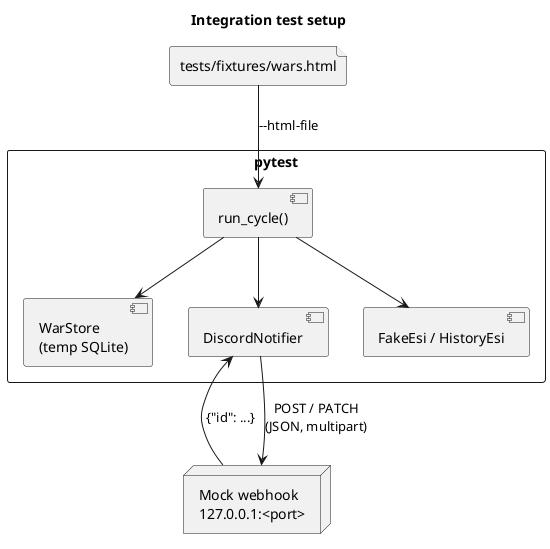

# Integration tests (automated)

[Home](Home.md) › Integration tests

| | |
|---|---|
| **Test code** | `tests/test_bot.py` · fixture `tests/fixtures/wars.html` |
| **Runs** | locally with `pytest -q` and on every push / PR (GitHub Actions `test-and-build`) |
| **Updated** | 2026-10-24 |

---

## 1. Test levels

| Level | What is real | What is replaced | Count |
|---|---|---|---:|
| Unit | Parser, report builder, config loader, statistics algorithm | ESI client (fake class), files | 8 |
| Integration | Full poll cycle: parser → SQLite store → embed builder → HTTP client → **local mock Discord webhook server**; `install` with a real bundle folder | DOTLAN (saved HTML file), ESI (fake class), Discord (local HTTP server) | 6 |
| Contract / end-to-end | — (planned, see §5) | — | 0 |



## 2. How to run

```bash
pip install -r requirements.txt pytest
pytest -q                      # all tests
pytest -q -k live_update       # one test
```

Expected: **14 passed**. In CI, the image is only built and pushed when all tests pass.

## 3. Test catalogue

| # | Test | Type | Stories | Proves |
|---:|---|---|---|---|
| 1 | <a id="test_parse_rows"></a>`test_parse_rows` | Unit | [US-01.02](user-stories/US-01.02.md) | IDs, parties, entity IDs, members, declared time, report URL from the saved page |
| 2 | <a id="test_full_names_status_and_date_order"></a>`test_full_names_status_and_date_order` | Unit | [US-01.02](user-stories/US-01.02.md), [US-01.03](user-stories/US-01.03.md) | full names from URLs, statuses, both date formats |
| 3 | <a id="test_bootstrap_silent_then_only_new"></a>`test_bootstrap_silent_then_only_new` | Integration | [US-01.04](user-stories/US-01.04.md), [US-01.05](user-stories/US-01.05.md), [US-02.01](user-stories/US-02.01.md), [US-03.01](user-stories/US-03.01.md), [US-06.02](user-stories/US-06.02.md) | silent first run, only the new war posted, no re-post after two simulated restarts, logo URL |
| 4 | <a id="test_non_silent_sends_all_and_filters"></a>`test_non_silent_sends_all_and_filters` | Integration | [US-02.01](user-stories/US-02.01.md), [US-02.06](user-stories/US-02.06.md) | all matching wars posted, status filter stores `filtered` |
| 5 | <a id="test_banner_multipart"></a>`test_banner_multipart` | Integration | [US-02.05](user-stories/US-02.05.md), [US-03.02](user-stories/US-03.02.md) | 4 wars in one message, multipart upload with `attachment://` references |
| 6 | <a id="test_build_report_and_embed"></a>`test_build_report_and_embed` | Unit | [US-04.01](user-stories/US-04.01.md), [US-04.02](user-stories/US-04.02.md), [US-03.03](user-stories/US-03.03.md) | score, tickers, allies, kills (newest first, side), hot systems, efficiency, links |
| 7 | <a id="test_report_before_war_start_has_no_kills"></a>`test_report_before_war_start_has_no_kills` | Unit | [US-04.01](user-stories/US-04.01.md) | no killmails before the war starts |
| 8 | <a id="test_live_update_edits_message"></a>`test_live_update_edits_message` | Integration | [US-04.03](user-stories/US-04.03.md), [US-04.04](user-stories/US-04.04.md) | PATCH on change, none when unchanged, final 'ended' edit, then stop |
| 9 | <a id="test_dry_run_never_touches_real_storage"></a>`test_dry_run_never_touches_real_storage` | Integration | [US-05.03](user-stories/US-05.03.md) | dry run uses a temporary database |
| 10 | <a id="test_install_unpacks_bundle_and_keeps_user_files"></a>`test_install_unpacks_bundle_and_keeps_user_files` | Integration | [US-06.08](user-stories/US-06.08.md) | bundle written, `.env` image ref, user files kept with `--force` |
| 11 | <a id="test_install_refuses_unwritable_or_missing_target"></a>`test_install_refuses_unwritable_or_missing_target` | Unit | [US-06.08](user-stories/US-06.08.md) | clear error for a missing target |
| 12 | <a id="test_credentials_folder_gives_clear_error"></a>`test_credentials_folder_gives_clear_error` | Unit | [US-05.01](user-stories/US-05.01.md) | folder instead of file → clear error |
| 13 | <a id="test_stats_counts_wars_on_first_day_of_month"></a>`test_stats_counts_wars_on_first_day_of_month` | Unit | [US-07.01](user-stories/US-07.01.md) | binary search finds exactly the wars of each 1st day (checked against brute force) with < 400 API calls |
| 14 | <a id="test_stats_bot_columns_from_database"></a>`test_stats_bot_columns_from_database` | Unit | [US-07.01](user-stories/US-07.01.md) | seen/posted counts from the database, `—` before the bot started |

Stories with at least one automated test: **19 of 34**.
Stories without an automated test yet: [US-01.01](user-stories/US-01.01.md), [US-01.06](user-stories/US-01.06.md), [US-02.02](user-stories/US-02.02.md), [US-02.03](user-stories/US-02.03.md), [US-02.04](user-stories/US-02.04.md), [US-04.05](user-stories/US-04.05.md), [US-05.02](user-stories/US-05.02.md), [US-06.01](user-stories/US-06.01.md), [US-06.03](user-stories/US-06.03.md), [US-06.04](user-stories/US-06.04.md), [US-06.05](user-stories/US-06.05.md), [US-06.06](user-stories/US-06.06.md), [US-06.07](user-stories/US-06.07.md), [US-06.09](user-stories/US-06.09.md), [US-07.02](user-stories/US-07.02.md).

## 4. Coverage gaps

| Gap | Story | Missing | Proposed test |
|---|---|---|---|
| G-01 | [US-02.02](user-stories/US-02.02.md) | 429 / 5xx handling has no automated test | Mock webhook returning 429 with `retry_after`, then 200; 500 twice, then 200. |
| G-02 | [US-02.03](user-stories/US-02.03.md) | Invalid webhook (401/404) → exit code 3 has no automated test | Mock webhook returning 404; assert exit 3 and unchanged attempts. |
| G-03 | [US-01.06](user-stories/US-01.06.md) | Layout-change handling (`ScrapeError`) has no automated test | HTML with a table but no war rows; one broken row among good rows. |
| G-04 | [US-02.04](user-stories/US-02.04.md) | Role mention / `allowed_mentions` has no automated test | Assert payload `content` and `allowed_mentions` with and without a role ID. |
| G-05 | [US-05.02](user-stories/US-05.02.md) | Settings defaults / overrides have no automated test | Load a partial YAML; assert defaults and overrides. |
| G-06 | [US-06.01](user-stories/US-06.01.md) | Container limits and hardening are not checked in CI | CI job: build image, `docker inspect` for user, read-only, memory/CPU. |
| G-07 | [US-01.02](user-stories/US-01.02.md) | Fixture is reconstructed, not a real saved DOTLAN page | Save the real page from a browser to `tests/fixtures/wars.html`. |

## 5. Planned integration / contract tests

| ID | Planned test | Stories |
|---|---|---|
| IT-P-01 | Contract test against live ESI (nightly, read-only): `/wars/`, `/wars/{id}/`, `/universe/names/` | [US-04.01](user-stories/US-04.01.md), [US-07.01](user-stories/US-07.01.md) |
| IT-P-02 | Discord sandbox channel: post, edit and delete a real message with banner | [US-02.01](user-stories/US-02.01.md), [US-03.02](user-stories/US-03.02.md), [US-04.03](user-stories/US-04.03.md) |
| IT-P-03 | Container smoke test in CI: build, `--check-config`, dry run, health check | [US-06.01](user-stories/US-06.01.md), [US-06.03](user-stories/US-06.03.md) |
| IT-P-04 | `setup-droplet.sh` / `revert-setup.sh` on a disposable Ubuntu 22.04 VM with a dummy web app | [US-06.05](user-stories/US-06.05.md), [US-06.06](user-stories/US-06.06.md) |

## 6. Rules for new tests

- Each new story gets at least one automated test, or a gap entry in §4 explaining why not.
- Tests never call real DOTLAN, ESI or Discord; those belong to the planned contract tests (§5) with a sandbox channel.
- Use `tmp_path` for databases; never touch `/data`.
- Add the test name to the story's *Verification* table (the wiki is generated from one backlog source).
