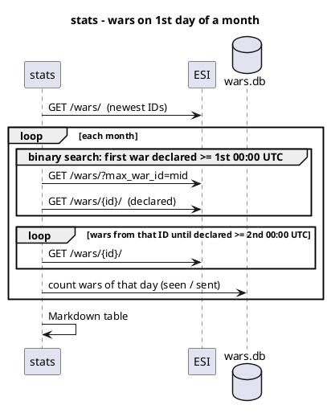

# Statistics — wars declared on the 1st day of each month

[Home](Home.md) › Statistics

| | |
|---|---|
| **Story** | [US-07.01](user-stories/US-07.01.md) · KPI [K-2 coverage](01-Vision.md#5-kpis), [K-10 freshness](01-Vision.md#5-kpis) |
| **Rule** | [BR-10](02-FRD.md#6-business-rules): wars **declared** between 00:00:00 and 23:59:59 UTC on the 1st day of a month |
| **Updated** | 2026-10-24 |

---

## 1. Data

> **No real numbers yet.** The statistics must be collected on the server: CCP ESI can't be reached from the environment where this wiki was written. Run the command in §3 and paste its output over the table below.

| Month | Wars declared on the 1st (UTC) | Mutual | Open for allies | Aggressor alliance / corp | Ended since | Seen by bot | Posted by bot |
|---|---:|---:|---:|---:|---:|---:|---:|
| 2025-11 | *pending* | | | | | — | — |
| 2025-12 | *pending* | | | | | — | — |
| 2026-01 | *pending* | | | | | — | — |
| 2026-02 | *pending* | | | | | — | — |
| 2026-03 | *pending* | | | | | — | — |
| 2026-04 | *pending* | | | | | — | — |
| 2026-05 | *pending* | | | | | — | — |
| 2026-06 | *pending* | | | | | — | — |
| 2026-07 | *pending* | | | | | — | — |
| 2026-08 | *pending* | | | | | — | — |
| 2026-09 | *pending* | | | | | — | — |
| 2026-10 | *pending* | | | | | — | — |

The bot was installed on **2026-10-23**, so the *Seen/Posted by bot* columns start with **2026-11-01**. For earlier months only the ESI history is available.

## 2. Column definitions

| Column | Meaning | Source |
|---|---|---|
| Wars declared on the 1st | Wars whose `declared` time falls on the 1st (UTC) | ESI `/wars/{id}/` |
| Mutual | … of which mutual wars | ESI `mutual` |
| Open for allies | … of which the defender accepts allies | ESI `open_for_allies` |
| Aggressor alliance / corp | … declared by an alliance / by a corporation | ESI `aggressor.alliance_id` |
| Ended since | … of which already finished or retracted when the report was generated | ESI `finished`, `retracted` |
| Seen by bot | Wars from that day in the bot database (any state) | `wars.declared_at` |
| Posted by bot | … of which posted to Discord (`state = sent`) | `wars.state` |

*Seen by bot* lower than *declared* means the bot missed wars. That feeds KPI [K-2](01-Vision.md#5-kpis), target ≥ 99 %. Wars that were declared and ended between two polls are the expected cause. *Posted by bot* lower than *seen by bot* is expected: it covers filters, the silent bootstrap and failed posts.

## 3. How to collect the numbers

On the server, in the bot folder:

```bash
bash scripts/bot.sh stats 12        # last 12 months; a few minutes
```

The command prints the table and saves it as `reports/war-stats-YYYY-MM-DD.md`. Copy the table into §1 of this page and commit it. For other tools there's JSON output too:

```bash
docker compose run --rm -T eve-war-bot stats --months 24 --json > reports/war-stats.json
```

**Monthly routine (K-10):** on the 2nd of each month, run `bash scripts/bot.sh stats 12` and update this page.

## 4. Method

War IDs increase with time, so the first war of a day is found by **binary search** over the war ID range. Only about 20 lookups are needed per boundary, instead of reading hundreds of thousands of wars. The wars of that day are then read one by one.



- **Load:** about 25 ESI calls per month plus one per war of that day. Results are cached during a run. The ESI error limit is respected.
- **Accuracy:** an automated test compares the search with a brute-force count on synthetic data (`test_stats_counts_wars_on_first_day_of_month`). The first real run should be spot-checked against zKillboard for one month ([MT-R-26](07-Manual-Test-Scenarios.md#mt-r-26)).
- **Limits:** a war deleted from ESI can't be counted. If ESI fails for one month, that row shows the error and the other months are still reported.
