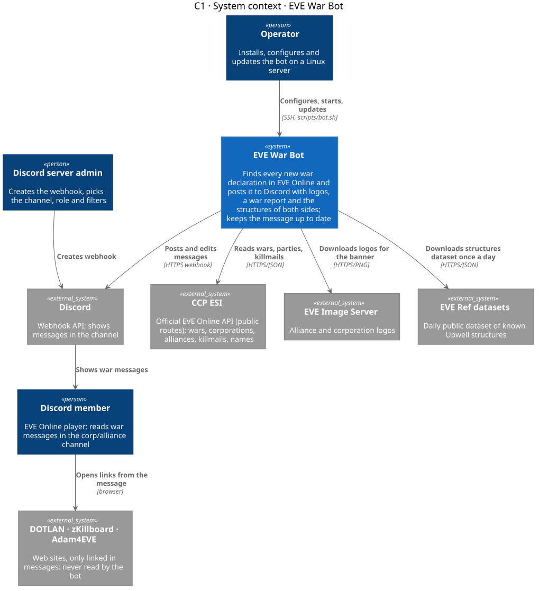
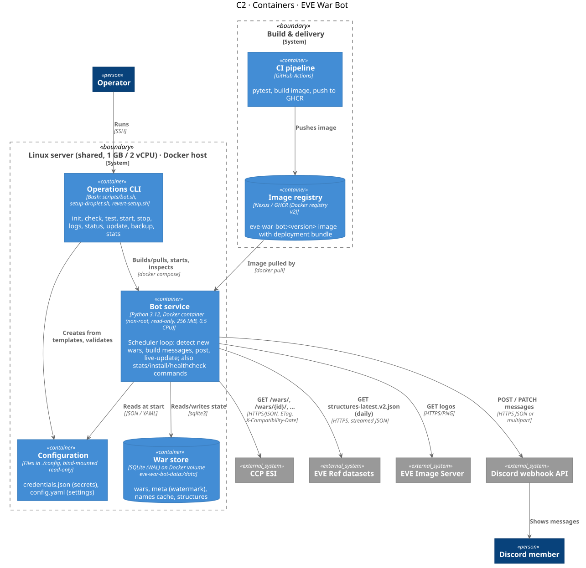
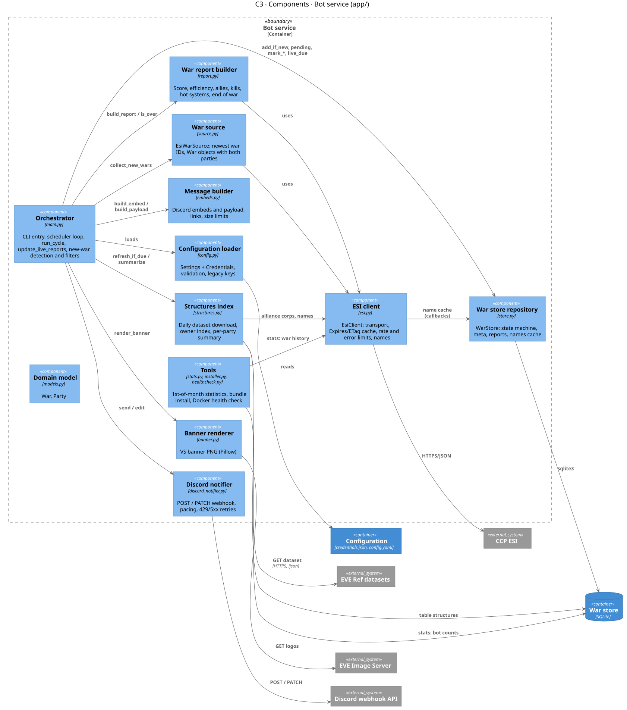
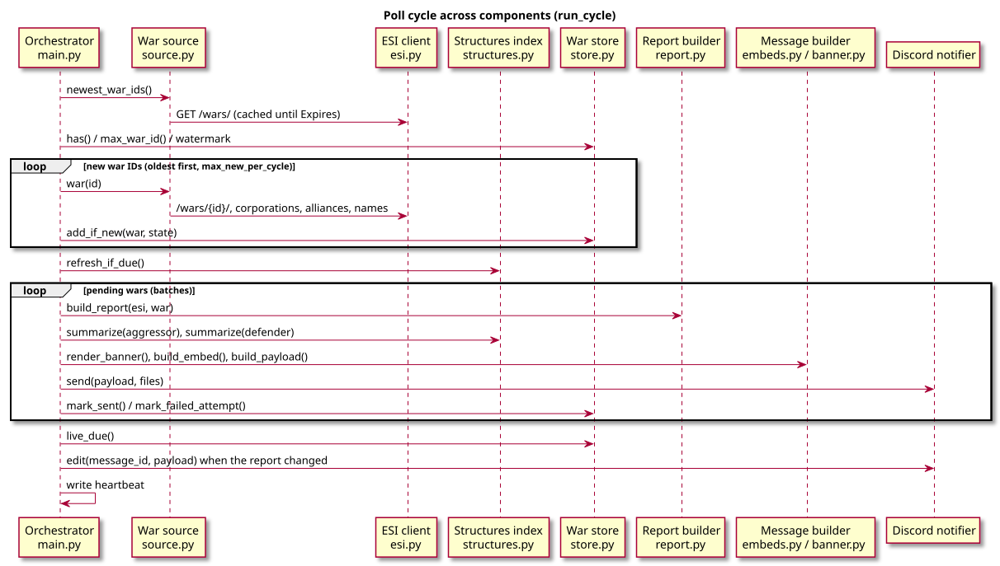
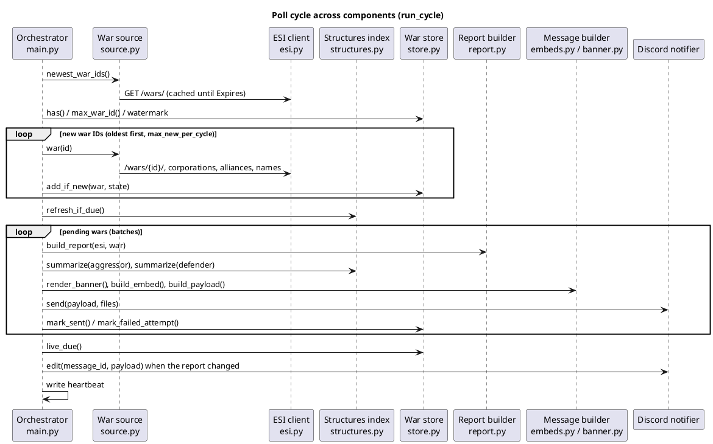
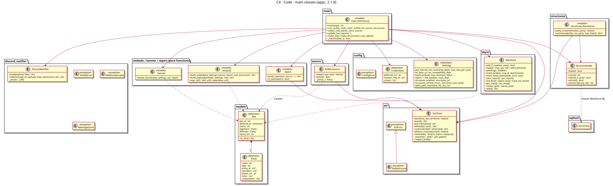

# Architecture (C4 model)

[Home](Home.md) › Architecture (C4)

| | |
|---|---|
| **Product** | EVE War Bot 2.1.0 |
| **Notation** | [C4 model](https://c4model.com/) drawn with [C4-PlantUML](https://github.com/plantuml-stdlib/C4-PlantUML) (`!include <C4/...>` from the PlantUML standard library) |
| **Source of truth** | Levels C1–C3 are maintained here. Level C4 is the code in `app/`; the class diagram below is a snapshot of release 2.1.0. |
| **Updated** | 2026-10-27 (2.1.0) |
| **Related** | [FRD](02-FRD.md) (requirements, interfaces, data model) · [technical README](../../README.md) |

---

## 0. How to read this page

| Level | Question it answers | Audience | Section |
|---|---|---|---|
| **C1 System context** | Who uses the bot, and which outside systems does it talk to? | Product owner, Discord admins, customers | [§1](#1-c1--system-context) |
| **C2 Containers** | Which deployable/runtime "boxes" make up the system, and what technology does each use? | Architect, operator | [§2](#2-c2--containers) |
| **C3 Components** | What is inside the bot service: which modules and what each is responsible for | Developer, analyst | [§3](#3-c3--components-of-the-bot-service) |
| **C4 Code** | Classes and functions | Developer | [§4](#4-c4--code) |

[§5](#5-code-structure-rules-and-target-layout) gives the dependency rules for the code and a proposed target package layout.

---

## 1. C1 — System context



<details><summary>PlantUML source</summary>

```plantuml
@startuml C1
!include <C4/C4_Context>
LAYOUT_TOP_DOWN

title C1 · System context · EVE War Bot

Person(member, "Discord member", "EVE Online player; reads war messages in the corp/alliance channel")
Person(admin, "Discord server admin", "Creates the webhook, picks the channel, role and filters")
Person(operator, "Operator", "Installs, configures and updates the bot on a Linux server")

System(bot, "EVE War Bot", "Finds every new war declaration in EVE Online and posts it to Discord with logos, a war report and the structures of both sides; keeps the message up to date")

System_Ext(esi, "CCP ESI", "Official EVE Online API (public routes): wars, corporations, alliances, killmails, names")
System_Ext(img, "EVE Image Server", "Alliance and corporation logos")
System_Ext(everef, "EVE Ref datasets", "Daily public dataset of known Upwell structures")
System_Ext(discord, "Discord", "Webhook API; shows messages in the channel")
System_Ext(links, "DOTLAN · zKillboard · Adam4EVE", "Web sites, only linked in messages; never read by the bot")

Rel(admin, discord, "Creates webhook")
Rel(operator, bot, "Configures, starts, updates", "SSH, scripts/bot.sh")
Rel(bot, esi, "Reads wars, parties, killmails", "HTTPS/JSON")
Rel(bot, everef, "Downloads structures dataset once a day", "HTTPS/JSON")
Rel(bot, img, "Downloads logos for the banner", "HTTPS/PNG")
Rel(bot, discord, "Posts and edits messages", "HTTPS webhook")
Rel(discord, member, "Shows war messages")
Rel(member, links, "Opens links from the message", "browser")
@enduml
```

</details>

| Element | Type | Role | Notes |
|---|---|---|---|
| Discord member | Person | Consumer of the notifications | Does not interact with the bot directly (no commands) |
| Discord server admin | Person | Owns the channel and the webhook | Hands the webhook URL to the operator |
| Operator | Person | Runs the bot | Only role that touches the server |
| CCP ESI | External system | **Main data source** | Rules: compatibility date, User-Agent, caching, rate limits ([C-01](02-FRD.md#8-constraints)) |
| EVE Image Server | External system | Logos | Discord also loads logo URLs itself |
| EVE Ref datasets | External system | Structures (since 2.1) | Replaces direct Adam4EVE reading, which its `robots.txt` forbids ([C-08](02-FRD.md#8-constraints)) |
| Discord | External system | Delivery channel | Outgoing webhooks only; no bot account, no incoming connection |
| DOTLAN · zKillboard · Adam4EVE | External system | Deep links for readers | Link only ([C-02](02-FRD.md#8-constraints)) |

---

## 2. C2 — Containers

> In C4, a *container* is a separately running or deployable unit (an application, a data store, a script). It is not necessarily a Docker container.



<details><summary>PlantUML source</summary>

```plantuml
@startuml C2
!include <C4/C4_Container>
LAYOUT_TOP_DOWN

title C2 · Containers · EVE War Bot

Person(operator, "Operator")
Person(member, "Discord member")

System_Boundary(host, "Linux server (shared, 1 GB / 2 vCPU) · Docker host") {
  Container(cli, "Operations CLI", "Bash: scripts/bot.sh, setup-droplet.sh, revert-setup.sh", "init, check, test, start, stop, logs, status, update, backup, stats")
  Container(svc, "Bot service", "Python 3.12, Docker container (non-root, read-only, 256 MiB, 0.5 CPU)", "Scheduler loop: detect new wars, build messages, post, live-update; also stats/install/healthcheck commands")
  ContainerDb(db, "War store", "SQLite (WAL) on Docker volume eve-war-bot-data:/data", "wars, meta (watermark), names cache, structures")
  Container(cfg, "Configuration", "Files in ./config, bind-mounted read-only", "credentials.json (secrets), config.yaml (settings)")
}

System_Boundary(build, "Build & delivery") {
  Container(ci, "CI pipeline", "GitHub Actions", "pytest, build image, push to GHCR")
  ContainerDb(reg, "Image registry", "Nexus / GHCR (Docker registry v2)", "eve-war-bot:<version> image with deployment bundle")
}

System_Ext(esi, "CCP ESI")
System_Ext(everef, "EVE Ref datasets")
System_Ext(img, "EVE Image Server")
System_Ext(discord, "Discord webhook API")

Rel(operator, cli, "Runs", "SSH")
Rel(cli, svc, "Builds/pulls, starts, inspects", "docker compose")
Rel(cli, cfg, "Creates from templates, validates")
Rel(svc, cfg, "Reads at start", "JSON / YAML")
Rel(svc, db, "Reads/writes state", "sqlite3")
Rel(svc, esi, "GET /wars/, /wars/{id}/, ...", "HTTPS/JSON, ETag, X-Compatibility-Date")
Rel(svc, everef, "GET structures-latest.v2.json (daily)", "HTTPS, streamed JSON")
Rel(svc, img, "GET logos", "HTTPS/PNG")
Rel(svc, discord, "POST / PATCH messages", "HTTPS JSON or multipart")
Rel(discord, member, "Shows messages")
Rel(ci, reg, "Pushes image")
Rel(reg, svc, "Image pulled by", "docker pull")
@enduml
```

</details>

| Container | Technology | Responsibility | Key decisions |
|---|---|---|---|
| **Bot service** | Python 3.12, `requests`, `PyYAML`, `Pillow`, `ijson`; image `python:3.12-slim` | All business logic; one process with a simple loop (no threads, no web server) | Python because of fast development, small memory (45–80 MiB typical) and good HTTP/JSON libraries. One process keeps the 1 GB shared server safe. No published ports: the bot only makes outgoing connections ([C-07](02-FRD.md#8-constraints)). |
| **War store** | SQLite in WAL mode on a named volume | De-duplication, retry state, watermark, live-update state, ESI name cache, structures index | Embedded database: no extra server, survives container re-creation, easy backup (`bot.sh backup`). Single writer, so no concurrency problems. |
| **Configuration** | `credentials.json` + `config.yaml`, whole folder mounted read-only | Secrets and behaviour without changing code | The folder is mounted, not single files, because single-file mounts went stale on Docker Desktop ([C-06](02-FRD.md#8-constraints)). Secrets never go into the image or git. |
| **Operations CLI** | Bash | Day-to-day operations in one command each | Never touches the firewall, ports, environment variables or sysctl, and never restarts other services ([NFR-07](02-FRD.md#7-non-functional-requirements)). |
| **CI pipeline** | GitHub Actions | Tests and image build on every push | The image is only pushed when the tests pass. |
| **Image registry** | Nexus or GHCR | Build once, install anywhere | The image carries its own deployment bundle (`install` command). |

**Not present on purpose:** no frontend or web UI, no cache server (the HTTP cache lives in process memory and the name cache in SQLite), no message queue, no Discord bot account.

---

## 3. C3 — Components of the bot service



<details><summary>PlantUML source</summary>

```plantuml
@startuml C3
!include <C4/C4_Component>
LAYOUT_LEFT_RIGHT

title C3 · Components · Bot service (app/)

ContainerDb(db, "War store", "SQLite")
Container(cfgfiles, "Configuration", "credentials.json, config.yaml")
System_Ext(esi, "CCP ESI")
System_Ext(everef, "EVE Ref datasets")
System_Ext(img, "EVE Image Server")
System_Ext(discord, "Discord webhook API")

Container_Boundary(svc, "Bot service") {
  Component(main, "Orchestrator", "main.py", "CLI entry, scheduler loop, run_cycle, update_live_reports, new-war detection and filters")
  Component(config, "Configuration loader", "config.py", "Settings + Credentials, validation, legacy keys")
  Component(source, "War source", "source.py", "EsiWarSource: newest war IDs, War objects with both parties")
  Component(esic, "ESI client", "esi.py", "EsiClient: transport, Expires/ETag cache, rate and error limits, names")
  Component(report, "War report builder", "report.py", "Score, efficiency, allies, kills, hot systems, end of war")
  Component(struct, "Structures index", "structures.py", "Daily dataset download, owner index, per-party summary")
  Component(embeds, "Message builder", "embeds.py", "Discord embeds and payload, links, size limits")
  Component(banner, "Banner renderer", "banner.py", "VS banner PNG (Pillow)")
  Component(notifier, "Discord notifier", "discord_notifier.py", "POST / PATCH webhook, pacing, 429/5xx retries")
  Component(store, "War store repository", "store.py", "WarStore: state machine, meta, reports, names cache")
  Component(models, "Domain model", "models.py", "War, Party")
  Component(tools, "Tools", "stats.py, installer.py, healthcheck.py", "1st-of-month statistics, bundle install, Docker health check")
}

Rel(main, config, "loads")
Rel(config, cfgfiles, "reads")
Rel(main, source, "collect_new_wars")
Rel(source, esic, "uses")
Rel(main, report, "build_report / is_over")
Rel(report, esic, "uses")
Rel(main, struct, "refresh_if_due / summarize")
Rel(struct, esic, "alliance corps, names")
Rel(struct, everef, "GET dataset", "HTTPS, ijson")
Rel(struct, db, "table structures")
Rel(main, embeds, "build_embed / build_payload")
Rel(main, banner, "render_banner")
Rel(banner, img, "GET logos")
Rel(main, notifier, "send / edit")
Rel(notifier, discord, "POST / PATCH")
Rel(main, store, "add_if_new, pending, mark_*, live_due")
Rel(store, db, "sqlite3")
Rel(esic, esi, "HTTPS/JSON")
Rel(esic, store, "name cache (callbacks)")
Rel(tools, esic, "stats: war history")
Rel(tools, db, "stats: bot counts")
@enduml
```

</details>

### 3.1 Component catalogue

| Component | Module | Responsibility | Public API (main entry points) | Depends on |
|---|---|---|---|---|
| Orchestrator | `main.py` | CLI (`--once`, `--check-config`, `install`, `stats`), signal handling, scheduler loop, the 4 steps of a cycle, filters, watermark | `main()`, `run_cycle()`, `collect_new_wars()`, `update_live_reports()`, `make_esi()`, `make_structures()`, `user_agent()` | all components below |
| Configuration loader | `config.py` | Read and validate `config.yaml` and `credentials.json`; defaults; 1.x keys; Windows BOM | `load_settings()`, `load_credentials()`, `Settings`, `Credentials`, `ConfigError` | PyYAML |
| War source | `source.py` | Translate ESI war data into `War`/`Party` objects (names, tickers, members, corporations, links) | `EsiWarSource.newest_war_ids()`, `.war(id)` | ESI client, Domain model |
| ESI client | `esi.py` | The only place that talks HTTP to ESI: version-less routes, `X-Compatibility-Date`, User-Agent, `Expires`/`ETag` cache, 429/420 handling, paging, name resolution | `EsiClient.wars() / war() / war_killmails() / killmail() / alliance() / alliance_corporations() / corporation() / names()`, `EsiError`, `EsiNotFound`, `parse_esi_time()` | requests |
| War report builder | `report.py` | Turn ESI war + killmails into a JSON report; decide whether the war is over | `build_report()`, `is_over()` | ESI client |
| Structures index | `structures.py` | Download the EVE Ref dataset (streamed, ETag), keep the `structures` table, summarise per party (corp or all alliance corps) | `StructureIndex.refresh_if_due() / refresh() / owned_by()`, `party_corporations()`, `summarize()` | ESI client, SQLite, ijson |
| Message builder | `embeds.py` | Pure functions: Discord embed fields, colours, timestamps, links (zKillboard, DOTLAN, Adam4EVE), Discord size limits | `build_embed()`, `build_payload()`, `logo_url()`, `zkill_url()`, `adam4eve_url()` | Domain model, Settings |
| Banner renderer | `banner.py` | Download two logos, draw the 640×220 "A VS D" PNG | `render_banner()` | Pillow, Image Server |
| Discord notifier | `discord_notifier.py` | Webhook transport: post (JSON or multipart), edit, pacing, retries, error types | `DiscordNotifier.send() / edit()`, `WebhookInvalid`, `MessageGone`, `NotifyError` | requests |
| War store repository | `store.py` | Schema and migrations; war state machine (`pending → sent / filtered / skipped / failed`); meta key/value; reports; live-update queue; name cache | `WarStore.add_if_new() / pending() / mark_sent() / mark_failed_attempt() / save_report() / live_due() / get_meta() / set_meta() / names_get() / names_put() / stats()` | sqlite3, Domain model |
| Domain model | `models.py` | Plain data classes, JSON-serialisable | `War`, `Party`, `War.to_dict()` | — |
| Tools | `stats.py`, `installer.py`, `healthcheck.py` | Monthly statistics from ESI history + database; unpack deployment bundle; Docker `HEALTHCHECK` from the heartbeat file | `stats.run()`, `installer.install()`, module `healthcheck` | ESI client, SQLite, Settings |

### 3.2 Runtime view: one poll cycle



<details><summary>PlantUML source</summary>



</details>

---

## 4. C4 — Code

> As the C4 authors recommend, this level is kept small: the code in `app/` is the source of truth. The diagram shows the classes and the most important functions of release 2.1.0 (about 2 150 lines of Python in 14 modules). Regenerate it when a class gets new public methods.

```plantuml
@startuml C4-code
title C4 · Code · main classes (app/, 2.1.0)
skinparam classAttributeIconSize 0
hide empty members

package models {
  class Party <<dataclass>> {
    name : str
    type : str
    entity_id : int?
    members : int?
    dotlan_url : str
    ticker : str?
    corporations : int?
  }
  class War <<dataclass>> {
    war_id : int
    declared_at : datetime?
    status : str
    aggressor : Party
    defender : Party
    report_url : str
    +to_dict() : dict
  }
  War *-- "2" Party
}

package config {
  class Settings <<dataclass>> {
    poll_interval_min, bootstrap_silent, max_new_per_cycle
    esi_base_url, esi_compatibility_date
    batch_embeds, max_attempts, filters ...
    report_*, live_updates, track_days
    structures_enabled, structures_url
    structures_refresh_hours, structures_max_listed
    sqlite_path, heartbeat_file, dry_run
  }
  class Credentials <<dataclass>> {
    webhook_url : str
    mention_role_id : str?
    contact : str?
  }
  class ConfigError <<exception>>
}

package esi {
  class EsiClient {
    +wars(max_war_id=None) : list[int]
    +war(id) : dict
    +war_killmails(id) : list
    +killmail(id, hash) : dict
    +corporation(id) / alliance(id) : dict
    +alliance_corporations(id) : list[int]
    +names(ids) : dict[int, (name, category)]
    -_request() / _get() / _get_pages()
    -_respect_limits()
  }
  class EsiError <<exception>>
  class EsiNotFound <<exception>>
  EsiError <|-- EsiNotFound
}

package source {
  class EsiWarSource {
    +newest_war_ids() : list[int]
    +war(id) : War?
    -_party(...) : Party
  }
}

package structures {
  class StructureIndex {
    +loaded : bool
    +count() : int
    +refresh_if_due() : bool
    +refresh() : bool
    +owned_by(corp_ids) : list
  }
  class "structures (functions)" as SF <<module>> {
    +party_corporations(esi, party) : list[int]
    +summarize(index, esi, party, max_listed) : dict?
  }
}

package store {
  class WarStore {
    +add_if_new(war, state) : bool
    +has(id) / max_war_id() / add_marker(id)
    +pending() : list[War]
    +mark_sent(ids, msg_id, attachments)
    +mark_failed_attempt(ids, error, max)
    +save_report() / get_report()
    +live_due() / expire_live() / mark_live_done()
    +get_meta() / set_meta()
    +names_get() / names_put()
    +stats() : dict
  }
}

package discord_notifier {
  class DiscordNotifier {
    +send(payload, files) : dict
    +edit(message_id, payload, keep_attachment_ids) : dict
    -_pace() / _call()
  }
  class NotifyError <<exception>>
  class WebhookInvalid <<exception>>
  class MessageGone <<exception>>
}

package "embeds / banner / report (pure functions)" as F {
  class embeds <<module>> {
    +build_embed(war, settings, banner, report, over, structures) : dict
    +build_payload(embeds, settings, role) : dict
    +logo_url() / zkill_url() / adam4eve_url()
  }
  class banner <<module>> {
    +render_banner(war, settings, ua) : bytes?
  }
  class report <<module>> {
    +build_report(esi, war_id, ...) : dict
    +is_over(report) : bool
  }
}

package main {
  class "main (functions)" as MF <<module>> {
    +main(argv) : int
    +run_cycle(s, creds, store, notifier, esi, source, structures)
    +collect_new_wars(s, store, source)
    +update_live_reports(...)
    +make_esi() / make_structures() / user_agent()
    -_matches(war, s) : bool
  }
}

EsiWarSource --> EsiClient
EsiWarSource ..> War : creates
StructureIndex ..> "sqlite3.Connection" : shares WarStore.db
SF --> StructureIndex
SF --> EsiClient
report --> EsiClient
embeds ..> War
banner ..> War
WarStore ..> War
MF --> Settings
MF --> Credentials
MF --> WarStore
MF --> EsiClient
MF --> EsiWarSource
MF --> StructureIndex
MF --> DiscordNotifier
MF --> embeds
MF --> banner
MF --> report
@enduml
```



<details><summary>PlantUML source</summary>



</details>

---

## 5. Code structure rules and target layout

### 5.1 Dependency rules (in force today)

The modules form layers. A module may only import from the same layer or a layer below.

| Layer | Modules | May import |
|---|---|---|
| 4 Application | `main.py`, `stats.py`, `installer.py`, `healthcheck.py` | everything below |
| 3 Services / presentation | `report.py`, `structures.py`, `embeds.py`, `banner.py` | layers 1–2 |
| 2 Adapters (I/O) | `esi.py`, `source.py`, `store.py`, `discord_notifier.py`, `config.py` | layer 1 and third-party libraries |
| 1 Domain | `models.py` | standard library only |

Rules that follow from it:

- **One gateway per external system.** Only `esi.py` talks HTTP to ESI, only `discord_notifier.py` to Discord, only `structures.py` to EVE Ref. Rate limits, caching and error handling live in one place.
- **No hidden I/O in presentation.** `embeds.py` is pure: same input, same output. This is why it is the easiest module to test.
- **Optional features never break the core.** `report` and `structures` return `None` on any error, and the orchestrator posts without them ([BR-06](02-FRD.md#6-business-rules), [BR-11](02-FRD.md#6-business-rules)).
- **Inject, don't construct.** `run_cycle()` receives `store`, `notifier`, `esi`, `source` and `structures` as parameters. The tests replace them with a fake ESI and mock HTTP servers.

Known deviations: `banner.py` imports `logo_url` from `embeds.py` (same layer, acceptable), and `StructureIndex` shares the `WarStore` SQLite connection instead of going through the repository.

### 5.2 Proposed target layout (for discussion, not implemented)

The flat `app/` folder is fine at 14 modules. If the bot grows (more sources, more channels), the following package layout makes the layers above explicit without changing any behaviour:

```yaml
app/
  domain/            # layer 1 – no I/O
    models.py        # War, Party
    rules.py         # filters (_matches), watermark logic, is_over
  adapters/          # layer 2 – one module per external system
    esi_client.py    # was esi.py
    war_source.py    # was source.py
    structures_dataset.py   # download + table (StructureIndex)
    discord_webhook.py      # was discord_notifier.py
    sqlite_store.py         # was store.py (+ structures table access)
    config_files.py         # was config.py
  services/          # layer 3 – use cases and presentation
    war_report.py    # was report.py
    structures.py    # summarize, party_corporations
    message.py       # was embeds.py
    banner.py
  app/               # layer 4 – entry points
    cli.py           # argument parsing (from main.py)
    scheduler.py     # loop, signals, heartbeat (from main.py)
    cycle.py         # run_cycle, collect_new_wars, update_live_reports
    stats.py
    installer.py
    healthcheck.py
```

| Change | Benefit | Cost / risk |
|---|---|---|
| Split `main.py` (350 lines) into `cli`, `scheduler`, `cycle` | Smaller units, the cycle can be tested without the CLI | Import paths in tests change |
| Move filters and the watermark rule into `domain/rules.py` | Business rules ([BR-03](02-FRD.md#6-business-rules), [BR-04](02-FRD.md#6-business-rules)) in one readable place | Small |
| Structures table access through the store repository | One owner for the database schema | `StructureIndex` loses its own connection handling |
| Optional: an import-linter rule in CI | The layer rules in §5.1 are checked automatically | One more dev dependency |

Recommendation: keep the flat layout for 2.x. Apply this refactoring only together with the next feature that adds a second source or a second delivery channel, so the change has a business reason and is covered by the existing 31 tests.
