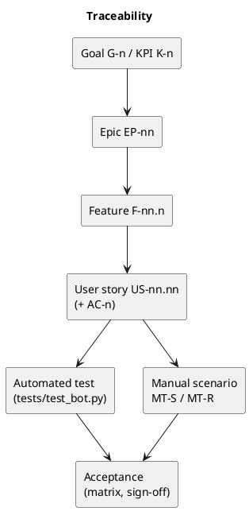

# EVE War Bot — Wiki

The EVE War Bot reads every new war declaration from **CCP's official EVE Online API, [ESI](https://developers.eveonline.com/docs/services/esi/overview/)**, and posts it to a Discord channel. Each message carries logos, a banner, the publicly known structures of both sides and a war report from CCP ESI that keeps updating while the war runs. It runs unattended in a small Docker container.

| | |
|---|---|
| **Release** | 2.1.0 (structures of each party; war source: ESI) |
| **Owner** | Andrii Kunitsyn (Business Analyst / Product Owner) |
| **Repository** | [Headruner/eve-war-bot](https://github.com/Headruner/eve-war-bot) |
| **Updated** | 2026-10-27 |

## Pages

| # | Page | What you find there |
|---|---|---|
| 1 | [Vision](01-Vision.md) | Problem, vision statement, stakeholders, goals, **KPIs**, scope, risks |
| 2 | [FRD](02-FRD.md) | **Epics and features**, business rules, non-functional requirements, constraints, interfaces, data model |
| 3 | [User stories](03-User-Stories.md) | Index of all stories; **one page per story** under [`user-stories/`](user-stories/) |
| 4 | [Acceptance testing](04-Acceptance-Testing.md) | Approach, entry/exit criteria, acceptance matrix, field evidence, defects, sign-off |
| 5 | [Integration tests](05-Integration-Tests.md) | Automated test catalogue, traceability to stories, coverage gaps, planned tests |
| 6 | [Statistics](06-Statistics.md) | **Wars declared on the 1st day of each month**: data, method, how to refresh |
| 7 | [Manual tests](07-Manual-Test-Scenarios.md) | **Sanity and regression** scenarios with story-point estimates |

Operational guides outside the wiki: [beginner manual](../MANUAL.md) · [technical README](../../README.md) · [server quick guide](../../deploy/DEPLOY.md).

## ID conventions

| Prefix | Example | Meaning |
|---|---|---|
| `G-` / `K-` | G-1, K-3 | Goal / KPI ([Vision](01-Vision.md)) |
| `EP-` | EP-04 | Epic |
| `F-<epic>.<n>` | F-04.3 | Feature of an epic |
| `US-<epic>.<n>` | US-04.03 | User story of an epic, one page each |
| `AC-<n>` | AC-2 | Acceptance criterion within a story |
| `BR-` / `NFR-` / `C-` | BR-02 | Business rule / non-functional requirement / constraint ([FRD](02-FRD.md)) |
| `MT-S-` / `MT-R-` | MT-R-14 | Manual test, sanity / regression suite |
| `G-0n` (tests) / `IT-P-` | G-01, IT-P-02 | Automated test gap / planned integration test |
| `DEF-` | DEF-03 | Defect found during acceptance |

## Traceability

## Editing this wiki

The story pages, the story index, the feature tables in the FRD, the acceptance matrix, the test catalogue and the manual scenarios are all generated from one backlog source, so IDs and links stay consistent. Ask for changes there rather than editing several pages by hand. The Vision, Statistics and Home pages are written by hand.

These pages are Markdown with PlantUML blocks. They render on GitHub; PlantUML needs a viewer or plugin (e.g. the VS Code *PlantUML* extension). To use them as a GitHub Wiki, copy the contents of `docs/wiki/` into the wiki repository. `_Sidebar.md` is the navigation there.
